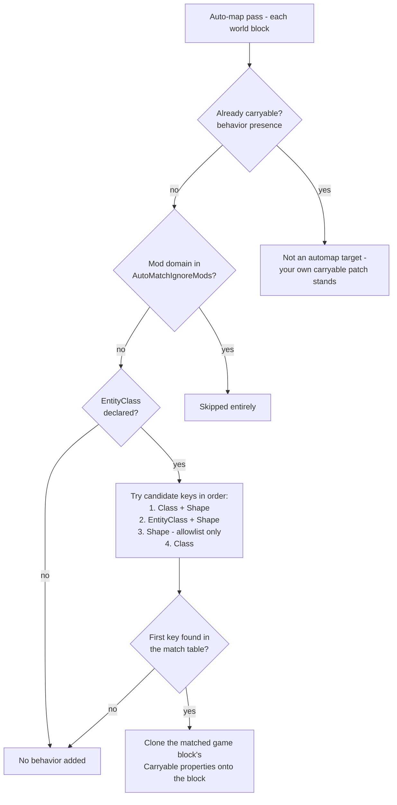

# Automatic Behavior Assignment

CarryOn can automatically extend carry support to modded blocks that are similar to known carryable blocks — no patch file required.

## Where It Runs

Auto-assignment runs **server-side** inside `BehavioralConditioning.Init` — once per world boot, and again after live config edits in Mode B (`DebuggingOptions.ReconditionOnConfigChange`). The match-and-clone logic lives in `BehaviorAutoMapper` and forms passes 5–6 of the conditioning pipeline. Every run starts with pass 0, which converges the live block registry back to the surface the world booted with, so auto-mapping always reads a fresh state:

0. **Converge to the per-world baseline** — un-create the clones earlier runs built, re-mount anything a previous pass changed, and adopt late registrations. On the first run of a world this step only *captures* the baseline.
4. Resolve multiple `Carryable` behaviors by priority/overlay.
5. **Auto-map similar `Carryable` behaviors.**
6. **Auto-map similar `CarryableInteract` behaviors.**
7. Strip still-disabled conditional behaviors — by *instance* (twin resolved in the other view), so unconditional siblings survive.
8. Remove the resolved priority-0 base on `RemoveBaseCarryableBehaviour` prefixes, from the union of both views.
9. Remove every carryable on `RemoveCarryableBehaviour` prefixes — type-wide, last.

Only blocks with **no carryable behavior present** can receive an auto-mapped clone. A block that carries its own `carryon:carryable` — conditional or not, enabled or not — is never an automap target. The same is true of a block whose base the base-removal pass took in an earlier run: pass 0 re-mounts it before auto-mapping so the block is not mistaken for an empty target.

See [Behavioral Conditioning](technical-overview/behavioral-conditioning.md) for the full pipeline and the ordering rationale.

## Enablement and Config

The feature is controlled by `CarryablesFilters.AutoMapSimilar` and defaults to enabled.

Other relevant filters:

- `AutoMatchIgnoreMods` default: `mcrate`
- `AllowedShapeOnlyMatches` defaults:
  - `block/clay/lootvessel`
  - `block/wood/chest/normal`
  - `block/wood/trunk/normal`
  - `block/reed/basket-normal`
- `RemoveBaseCarryableBehaviour` default: `woodchests:wtrunk` — applied *after* auto-mapping, so an auto-mapped clone on a matched code is removed too (see below).
- `RemoveCarryableBehaviour` defaults:
  - `game:banner`
  - `game:clutter-devastation`

## Matching Strategy

CarryOn builds a match table from **game-domain** blocks that already have `Carryable` behavior, keyed by their class / entityClass / shape signatures.

For each candidate block, potential match keys are checked in this order:

1. `Class:<class>|Shape:<shape>`
2. `EntityClass:<entityClass>|Shape:<shape>`
3. `Shape:<shape>`
4. `Class:<class>` (the only key when the block has no shape)

Important behavior:

- A candidate block must declare a non-null `entityClass`. Blocks without one are skipped before their keys are generated, so a `class`/`shape` match alone will not get them a clone.
- Shape-only matches are only allowed for shapes in `AllowedShapeOnlyMatches`.
- The generic shape `block/basic/cube` is intentionally excluded from shape matching.
- First matching key wins.
- Blocks from ignored mod domains are skipped.

## What The Clone Inherits

An auto-mapped block receives the source block's full `Carryable` properties — transform templates and groups, carry slots, hunger and speed modifiers — in both of its behavior arrays. It is worth being precise about the shape: the automapper builds **one instance per view** (two distinct objects initialized from the same donor properties), whereas a carryable the engine or a patch loads — including a blocktype's own `behaviors` entry — is a **single instance referenced from both arrays**. Every later pass is written for both shapes.

Two consequences worth knowing:

- **The clone inherits the source's conditions.** Match sources are vanilla blocks patched by CarryOn, and those patches are typically conditional (`enabledCondition` such as `carryon.Carryables.Chest`). Your chest-like mod block therefore follows the same config toggles as its vanilla counterpart — disable chests, and the automapped clone is stripped by the same conditional pass.
- **A disabled conditional never earns a substitute.** If your block carries its own conditional `carryon:carryable` and the condition is false, the behavior stays mounted while auto-mapping runs (by design — and a Mode B recondition run's pass 0 re-mounts it first if a prior run's final pass stripped it), so the block is *not* an automap target — no vanilla clone is injected — and the disabled behavior is stripped afterwards. The block is simply non-carryable until its condition becomes true.

## Auto-Mapping And `RemoveBaseCarryableBehaviour`

The base-removal pass runs *after* auto-mapping, so the two interact in ways that are worth planning around:

- **An auto-mapped clone on a matched code is removed too.** If your code matches a `RemoveBaseCarryableBehaviour` prefix and the automapper gave it a clone, the clone is the block's only carryable and is treated as its base. Filtering that prefix out therefore makes an auto-mapped block non-carryable.
- **A positive `patchPriority` protects the block.** The clone inherits the donor's `patchPriority`. If the resolved survivor on a matched block has `patchPriority > 0`, the block is kept — the carve-out exists so a mod that fully replaces a block type is not stripped by a filter aimed at the base.
- **Clearing the prefix is reversible in-session.** The pass flags what it removed, and the next run's pass 0 re-mounts it from the per-world baseline, so removing the prefix from the config restores the block's prior surface without a world restart. A `RemoveCarryableBehaviour` prefix works the same way: clearing it re-mounts the block's boot behaviors and the later passes re-derive, so an auto-mapped clone returns and an overlay is re-merged. See [Behavioral Conditioning](technical-overview/behavioral-conditioning.md#33-what-a-recondition-can-and-cannot-undo) for the full undo table.

## CarryableInteract Auto-Mapping

Carryable interaction behavior is also auto-mapped, purely on `EntityClass`, when:

- A block does not already have `CarryableInteract`.
- Its `EntityClass` matches a known interact-enabled block (sources exclude `Generic`).
- Its mod domain is not excluded by `AutoMatchIgnoreMods`.

## When Auto-Assignment Is Enough

Auto-assignment is usually enough when:

- Your block shares class/entity/shape characteristics with vanilla carryable blocks.
- You are fine with inherited defaults — including the source block's config toggles.

## When To Add A Manual Patch

Add your own patch when you need:

- Custom animations, speed penalties, or slot restrictions.
- Back-carry conditions for your block family.
- Custom transform templates or label placement.
- Different enable conditions than the vanilla source block.
- Explicit behavior when matching is ambiguous.

Use [Modding Guide](modding-guide.md) for patch examples and field reference.
