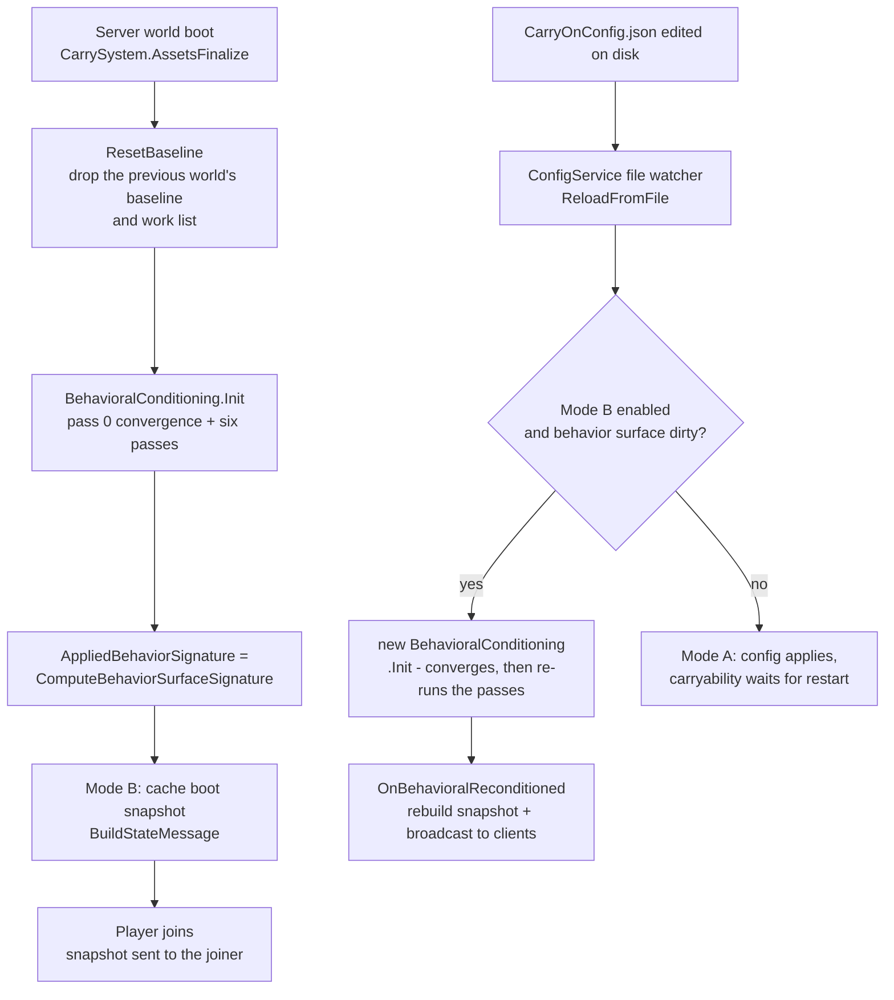
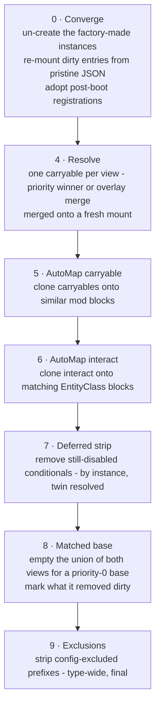
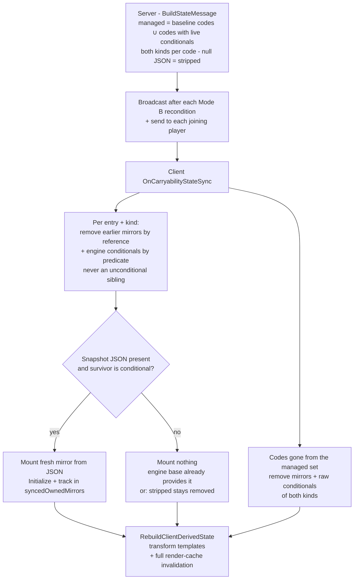

# Behavioral Conditioning in CarryOn

This document explains how `BehavioralConditioning` processes block behaviors at world load time — and, in Mode B, after live config edits — to establish the final set of carryable behaviors on every block.

It reflects the current implementation:

- `BehavioralConditioning.Init` runs a **convergence pass** (pass 0) and then six derivation passes over all world blocks, executed by five collaborating classes (`BehavioralConditioning`, `ConditioningBaseline`, `BlockFilter`, `MultipleBehaviorResolver`, `BehaviorAutoMapper`).
- Every behavior the world boots with is captured as a **per-world baseline** before any pass can mutate it, and pass 0 restores that baseline at the start of every later run — so each run **converges** to what a fresh boot with the same config would produce, and every filter edit is reversible in both directions (§3).
- All conditioning removal is **instance-owned**: a behavior is removed by reference or by its `CreatedByConditioning` marker, never by runtime type — so an unconditional sibling of the same kind always survives (the coexistence fix).
- Multiple `BlockBehaviorCarryable` instances are resolved by `patchPriority`, with optional property overlays when `overrideExistingProperties` is enabled, and condition-aware candidate selection. The resolver is **config-independent**: it decides which carryable survives and nothing else. The merge lands on a **fresh mount** every run, so an overlay's contribution survives any number of reconditions.
- `RemoveBaseCarryableBehaviour` is its own **late, union-level** pass (pass 8): it removes the resolved priority-0 base from *every* view that holds it and marks it dirty, which is what makes the removal reversible on the next run (pass 0).
- Auto-mapping extends carryable coverage to mod blocks that share game-block signatures, and only ever targets blocks with *no* carryable behavior present. Its clones are marked, so the next run un-creates them before the passes re-derive.
- Config-driven exclusions strip carryable behaviors from explicitly blocked code prefixes, last.
- In Mode B (`DebuggingOptions.ReconditionOnConfigChange`), a config edit re-runs the whole pipeline and broadcasts a **carryability snapshot**; the client reconciles onto it with the same instance-owned semantics.

## 0. Scope

- `src/Server/Logic/BehavioralConditions/BehavioralConditioning.cs` — the pass order, the snapshot build
- `src/Server/Logic/BehavioralConditions/ConditioningBaseline.cs` — the per-world baseline, pass 0 (`RestoreBaseline`), the work list, the `Dirty` flag
- `src/Server/Logic/BehavioralConditions/BlockFilter.cs` — deferred disabled-conditional removal, matched-base removal, exclusion removal, array helpers
- `src/Server/Logic/BehavioralConditions/MultipleBehaviorResolver.cs` — priority/overlay resolution
- `src/Server/Logic/BehavioralConditions/BehaviorAutoMapper.cs` — signature-based auto-mapping
- `src/CarrySystem.Lifecycle.cs` — boot site (`ResetBaseline`, first `Init`), Mode B join hook
- `src/CarrySystem.Configuration.cs` — client-side snapshot reconciliation
- `src/Common/Logic/CarryOnConfigService.cs` — Mode B reload re-run
- [src/API/Common/Interfaces/IConditionalBlockBehavior.cs](https://github.com/NerdScurvy/CarryOnLib/blob/main/src/API/Common/Interfaces/IConditionalBlockBehavior.cs)
- `src/Common/Models/Config/CarryablesConfig.cs` (`CarryablesFiltersConfig`)
- `src/Common/Behaviors/BlockBehaviorCarryable.cs` (`PatchPriority`, `OverrideExistingProperties`, `ForcePickupOnSwapBack`, the `CreatedByConditioning` marker)

---

## 1. When Conditioning Runs

`BehavioralConditioning.Init(api, config)` runs on the **server side only**, at two kinds of moments:

| Trigger | Site | Notes |
|---------|------|-------|
| World boot | `CarrySystem.AssetsFinalize` (`src/CarrySystem.Lifecycle.cs`) | Calls `ConditioningBaseline.ResetBaseline()` first, then the first `Init`; under Mode B it also caches the boot snapshot served to joiners |
| Live config edit | `CarryOnConfigService.ReloadFromFile` | **Mode B only** (the *boot-time* `ReconditionOnConfigChange` latch, not the reloaded file's value) and only when the *behavior surface signature* is dirty; Mode A (default) preserves restart-only semantics. The pass re-runs from the per-world baseline, so the edit converges instead of accumulating, and no **config** edit is one-way — the same path serves the file watcher and `/carryon-reload` |

**Mode A still runs the boot pass, and has to.** Mode A does not skip conditioning —
only the *reload-triggered* re-run is gated off. The first `Init` at `AssetsFinalize` runs
identically in both modes, because it is what establishes the per-world baseline and the
derived carryability surface for a fresh boot. So Mode A pays for a full Mode-B-shaped
pipeline even though it never re-runs it mid-session, and that is deliberate: the baseline
captured by the boot pass is exactly what makes a *later* pass reversible. Without it there
would be no pristine JSON to restore from, and the Mode B re-run (and the boot snapshot it
feeds) would have no convergence property. The gate is on the second and later runs, not on
the first.

The conditioning baseline is static state that would otherwise survive world boots in-process (world reloads, test hosts) — `ConditioningBaseline.ResetBaseline()` drops it once per world so the first pass re-captures from that world's freshly loaded behaviors and never restores a previous world's surface.



Because the reload re-runs the *same* pipeline against the *live* block registry — and pass 0 has already put the registry back to its boot shape — every pass is a pure function of (baseline, config, world state) rather than of run history: the resolver re-deduplicates, the automapper re-clones, and the strips re-apply slot-level conditions, none of them compounding on the last run.

---

## 2. Pipeline Order

`Init` runs one **convergence** step and then six derivation passes, in this fixed order:

| # | Class · Method | Derives from | Purpose |
|---|----------------|--------------|---------|
| 0 | `ConditioningBaseline.RestoreBaseline` | the per-world baseline + the current work list | Un-create the instances CarryOn's factory built (automap clones, earlier remounts), re-mount every dirty entry from its pristine JSON, and adopt any behavior a later registration appended — so the surface is a fresh boot's again before anything derives from it |
| 4 | `MultipleBehaviorResolver.Resolve` | pass 0's surface | Deduplicate `BlockBehaviorCarryable` per block by patch priority / overlay merge, landing the merged result on a fresh mount |
| 5 | `BehaviorAutoMapper.AutoMapSimilarCarryables` | pass 4's resolved surface | Extend carryable to non-game blocks by shape/class/entityClass signature |
| 6 | `BehaviorAutoMapper.AutoMapSimilarCarryableInteract` | pass 5's surface | Extend carryable-interact to matching-entityClass blocks |
| 7 | `BlockFilter.RemoveDisabledConditionalBehaviors` | every block still holding a conditional | Strip behaviors whose `EnabledCondition` still evaluates false — **by instance**, twin resolved per view |
| 8 | `BlockFilter.RemoveMatchedBaseCarryableBehaviors` | the **resolved union** of both views | Remove the union's priority-0 base on `RemoveBaseCarryableBehaviour` prefixes — **by reference**, and mark what it removed dirty |
| 9 | `BlockFilter.RemoveExcludedCarryableBehaviors` | the finished surface | Remove carryable from config-blocklisted code prefixes — type-wide, final |

Passes 1–3 of the previous revision (the conditional capture, the removed-base restore, and reconcile) are **gone**: pass 0 subsumes all three, and with them the per-pass ownership records they needed. The remaining passes keep their old numbers so the cross-references in this document and in `automatic-behavior-assignment.md` still resolve.

After pass 9, `Init` injects the ground-storage-bag help behavior when `CarryOptions.PickupGroundStorageBagWhileCarrying` is not `false`. That step is a carry-option convenience, not a conditioning pass, and does not participate in the ordering rules below.



**Why this order — three deferral invariants.**

*Convergence first (pass 0).* Every pass below mutates blocks, so pass 0 has to run before all of them: a behavior a previous run stripped or replaced must be back to its boot shape before the resolver judges it, before the automapper decides whether the block is a clone target, and before the filters match a prefix against it. Running it first is also what makes the pipeline a pure function of (baseline, config, world state) instead of a function of run history — the property §3.1 is built on.

*Disabled conditionals (pass 7).* Disabled conditional behaviors are *kept mounted* while the automapper runs, and only stripped in pass 7. This is deliberate and load-bearing:

1. **A disabled block is never a map target.** `IsCarryable()` is behavior presence (`block.HasBehavior<BlockBehaviorCarryable>()`). While the disabled conditional is still mounted, the automapper's `!w.IsCarryable()` filter skips the block. If the behavior were stripped before auto-mapping, a behaviorless block could receive a carryable *cloned from an enabled "similar" source* — arriving with the source block's transforms and straps, wrong for the target, and re-enabling a block the server config had disabled.
2. **Twins cloned from a disabled source inherit the disabled condition** (`enabledCondition` is part of the cloned properties) and are stripped by the same final pass.

Pass 0 keeps this invariant true on **every** run, not just the boot run: pass 7 marks each entry it strips, so pass 0 re-mounts it from its pristine JSON before the automapper can mistake the behaviorless block for a clone target (§3.6) — without that, a boot-stripped chest would be a map target for any same-signature donor enabled under a different toggle (the reed chest and fancy storage vessel share `Class:BlockGenericTypedContainer` with the chest). The same mechanism **replaces** the old removed-base shield: a base that pass 8 emptied is marked dirty, so pass 0 re-mounts it and pass 8 empties it again in the same run — the shield is never observable in the finished surface.

*Resolution and exclusions.* Auto-mapping (passes 5–6) runs *after* resolution (pass 4) so newly cloned behaviors enter clean blocks and never need deduplication themselves — and so a clone is built from the donor's **merged** properties, which is what keeps a donor and its automap twins byte-identical. Swapping passes 4 and 5 is a divergence, not a harmless reorder: the clone would then be made from the pre-merge donor and would differ from it. The base pass (pass 8) runs after the automapper so it sees **every** view a carryable can live in and judges the *resolved* result rather than a pre-resolution input. Exclusions (pass 9) run last so they also remove auto-mapped results and nothing later re-adds a behavior.

---

## 3. The Conditioning Baseline (pass 0)

### 3.1 The contract

Conditioning used to track ownership **per pass**: the conditional capture owned what reconcile remounted, the matched-base pass owned its own removal records, and everything else was unowned. Two consequences followed, and both were bugs — a run could not undo a mutation made by an earlier run (so every pass needed its own inverse), and the ownership gaps made some config edits one-way until a server restart. The baseline replaces that with a single **per-world** ownership record.

`ConditioningBaseline` (`src/Server/Logic/BehavioralConditions/ConditioningBaseline.cs`, `internal static`) holds, keyed by block code, every `BlockBehaviorCarryable` / `BlockBehaviorCarryableInteract` the world **booted** with — conditional or not, one list per code because a block can boot with several:

| Field | Meaning |
|-------|---------|
| `Kind` | `carryon:carryable` or `carryon:carryableinteract` |
| `BlockSide` / `CollectibleSide` | which view(s) the behavior booted in — both set means one instance shared by both arrays |
| `PristineJson` | its properties JSON as captured, before any pass mutated it; never re-captured from live state, never mutated |
| `Restore` | `Json` (mount a fresh instance from `PristineJson`) or `InstanceReference` (a behavior appended without `Initialize`, so the recorded object is the only restore source) |
| `Instance` | the live object that currently represents the entry, so a remount can drop the stale one by reference |
| `Dirty` | set by any pass that mutated or removed the entry's live behavior |

Two per-world collections sit beside it: the **work list** (`touchedCodes`) of every code any pass marked dirty or the automapper appended a clone to — monotonic for the life of the world, so a clone an earlier run created is still un-creatable after the config stops re-creating it — and `ManagedCodes`, the managed set the client snapshot is built from (§10.1).

The store is static and reset per world at the boot site by `ResetBaseline()`, immediately before the first `Init` (`src/CarrySystem.Lifecycle.cs`). The reset is not optional: static state that outlived a world boot would restore the previous world's surface onto blocks this world never booted with.

**The marker.** `BlockBehaviorCarryable.CreatedByConditioning` (and its interact twin) is an `internal`, non-serialized flag meaning "CarryOn's factory built this instance". Only three sites set it: the baseline's `MountFromBaseline`, the resolver's merge mount, and the automapper's appends. It is the discriminator between *engine- or mod-authored* (baseline-owned, restored by re-mount) and *CarryOn-made* (un-created wholesale), and it is `internal` so mod authors cannot accidentally set it.

### 3.2 What pass 0 does

`RestoreBaseline(api, fullRestore)` is pass 0. On the **first** run of a world it captures an entry for every block and returns — nothing has been mutated yet, so there is nothing to restore. On every later run it runs three steps, in order:

1. **Un-create.** For every work-list code, drop every *marked* instance from both views. This is the un-clone mechanism: anything CarryOn constructed is removable by construction, which is what makes automapping reversible — a run with `AutoMapSimilar: false` simply does not re-create what an earlier run cloned.
2. **Re-mount.** For every **dirty** entry, remove the entry's stale live object by reference from both views, then mount a fresh instance from `PristineJson` (or re-add the recorded object for an `InstanceReference` entry) into exactly the views it booted in, and clear the flag. The JSON is parsed per mount, so an entry restored into both views as one shared instance still gets its own copy of the properties.
3. **Extend.** `EnsureBaseline` every work-list block, so a behavior registered *after* the boot capture is adopted as an entry before any pass can mutate it.

Two bookkeeping calls are the whole contract for the rest of the codebase: `EnsureBaseline(block)` before a pass mutates a block it has not seen, and `MarkDirty(block, instance)` at every mutation site. The automapper's appends use `NoteTouched(code)`, which adds the code to the work list without marking an entry dirty — a clone has no entry by design, and the un-create sweep owns it.

`DebuggingOptions.ReconditionFullRestore` (default `false`) treats **every** baseline entry as dirty. It is the full-restore fallback for live debugging and the cross-check for a convergence bug: if a full restore fixes the surface, a `Dirty` flag was missed somewhere.

### 3.3 What a recondition can and cannot undo

This is the canonical table for the question. The three "restart" caveats that used to be duplicated across `carryon-config.md`, this document and `automatic-behavior-assignment.md` all resolve here.

| Edit (a Mode B config reload, or a mod's own late registration) | Undo mechanism | Effect gone after |
|---|---|---|
| `Carryables` / `CarryablesOnBack` / `Interactables` toggle | pass 7 strips by instance and marks the entry dirty; pass 0 re-mounts it | one conditioning run |
| `RemoveBaseCarryableBehaviour` prefix gained **or** cleared | pass 8 marks the base dirty; pass 0 re-mounts it | one conditioning run |
| `RemoveCarryableBehaviour` prefix gained **or** cleared | pass 9 strips type-wide; pass 0 re-mounts the boot behaviors, the resolver re-derives the merge, the automapper re-clones | one conditioning run |
| `AutoMapSimilar` turned off, or back on | clones are marked, so pass 0 un-creates them; the automapper re-clones only while it is on | one conditioning run |
| `AutoMatchIgnoreMods` domain gained or dropped | the same un-create path | one conditioning run |
| `AllowedShapeOnlyMatches` shape gained or dropped | the same un-create path | one conditioning run |
| An `overrideExistingProperties` overlay's contribution | the overlay is a baseline entry; the resolver merges it into a fresh mount every run | never lost |
| A behavior **registered after** the world booted | `EnsureBaseline` adopts it during the run that first sees it, so later runs restore it like any boot behavior | one run after adoption |
| **A live edit to a behavior's own properties** (a JsonPatch or an API caller writing `Properties` after boot) | none — the baseline JSON is authoritative | **restart required, by design** — see §3.4 |
| Engine assets, world blocks, anything CarryOn does not own | none — out of conditioning's scope | server restart |

Rows 1–8 are exactly the classes the interim non-reversible-edit warning used to name; that warning (and its detector) has been removed, because it described a loss that no longer happens. Only the last two rows are one-way, and neither is a config edit.

### 3.4 Why a live properties edit is reverted

A post-boot write to a captured behavior's own properties is **not** preserved: the next pass 0 re-mounts the entry from the pristine boot JSON, so the edit is reverted. This is the deliberate cost of boot-pristine-wins, and it is the property that makes every other row of §3.3 possible:

- Re-deriving authored properties from the patch pipeline on every run is a different project: it would make the patch pipeline, not the world boot, the source of truth, and every pass would have to be re-audited against it.
- Treating the live properties as the new baseline instead would make each run's result depend on the previous run's mutations — precisely the compounding this design removes.
- Nothing legitimate is lost: a world restart re-reads every patch, so only in-session edits are reverted.

This is classified a **restart-required-by-design** behavior rather than an open defect: the fix would be a separate project (see the first bullet above), and nothing in the shipped config surface promises otherwise.

### 3.5 What counts as "conditional"

`BehavioralConditioning.IsConditionalBehavior(behavior)` is the single shared predicate (used by the deferred strip and by the client mirror):

- A `BlockBehaviorCarryable` with a **non-whitespace block-level `EnabledCondition`**, *or* any slot in `Slots.SlotSettingsDict` carrying a non-whitespace `enabledCondition`
- A `BlockBehaviorCarryableInteract` with a non-whitespace `EnabledCondition`

Empty/whitespace conditions mean "no condition" and are never treated as conditional anywhere (the strip and the resolver both guard on whitespace rather than depending on how the engine would evaluate an empty string). Note the deliberate asymmetry: the **baseline** captures every CarryOn-type behavior, while only the strip's predicate is conditional-specific.

`IConditionalBlockBehavior` (CarryOnLib) is what both behaviors implement. `EnabledCondition` is a dot-notation world-config expression (e.g. `"carryon.Carryables.Chest"`), evaluated against the world config tree via `EvaluateDotNotationLogic`; `ProcessConditions(api, block)` is called only once the behavior is confirmed enabled, so the behavior can do any setup it needs.

### 3.6 The deferred strip (pass 7)

`BlockFilter.RemoveDisabledConditionalBehaviors` walks every block still carrying an `IConditionalBlockBehavior`:

- Condition present and evaluates **false** → the behavior instance is removed **by reference** (`RemoveBehavior`) from `BlockBehaviors`, mirrored into `CollectibleBehaviors` through `RemoveBehaviorAcrossViews`, and its baseline entry marked dirty so pass 0 puts it back next run. Any unconditional — or differently-conditioned — sibling of the same type survives.
- Condition absent or **true** → `ProcessConditions(api, block)` runs, re-applying slot-level conditions (a behavior pass 0 re-mounted has its still-disabled slots re-stripped here).

**Why the collectible view needs twin resolution.** The two views do not always hold the same object. A patch-loaded or baseline-remounted carryable is *one* instance referenced from both arrays, so reference removal from `CollectibleBehaviors` is exact. An automap clone, however, is built once per view from the same donor properties, so the collectible view holds a **twin** that is not reference-equal to the block-side instance. `RemoveBehaviorAcrossViews` therefore tries reference removal first and falls back to `FindViewTwin` — a `BlockBehaviorCarryable` whose `EnabledCondition` and `PatchPriority` match, the properties an automap clone pair shares. A differently-conditioned or differently-prioritized sibling of the same type is deliberately left mounted. Without that fallback, a condition-disabled block stayed carryable through the collectible view (its `IsCarryable()` is an OR over both arrays).

### 3.7 Examples

**Conditional carryable, block and slot level** (from `resources/assets/carryon/patches/carryable/chest.json`):

```json
{
  "file": "game:blocktypes/wood/chest",
  "side": "Server",
  "op": "add",
  "path": "/behaviors/-",
  "value": {
    "name": "carryon:carryable",
    "properties": {
      "enabledCondition": "carryon.Carryables.Chest",
      "slots": {
        "Hands": { },
        "Back": {
          "enabledCondition": "carryon.CarryablesOnBack.Chest",
          "walkSpeedModifier": -0.15
        }
      }
    }
  }
}
```

- Block-level: the chest is carryable at all only while `carryon.Carryables.Chest` is true in the world config tree.
- Slot-level: the `Back` slot only exists while `carryon.CarryablesOnBack.Chest` is true; when false, `ProcessConditions` strips the slot from the live behavior (the baseline's pristine JSON retains it, which is what puts the slot back when the toggle comes back).

**Composite conditions** are supported by the dot-notation evaluator (real patches):

```json
"enabledCondition": "carryon.Carryables.Chest&&carryon.CarryOptions.AllowHighCapacityStorageOnBack"
"enabledCondition": "carryon.Carryables.Clutter&carryon.Carryables.Bookshelf"
```

**Coexistence — an unconditional base plus a conditional patch** (from the CarryEntityDemo test block):

```json
"behaviors": [
  {
    "name": "carryon:carryable",
    "properties": {
      "patchPriority": 2,
      "slots": { "Hands": { }, "Back": { "walkSpeedModifier": -0.2 } }
    }
  },
  {
    "name": "carryon:carryable",
    "properties": {
      "patchPriority": 1,
      "enabledCondition": "carryon.Carryables.Chest",
      "slots": { "Hands": { } }
    }
  }
]
```

Outcome table for this block:

| World config state | Pipeline result |
|---|---|
| `Chest = false` at boot | Pass 0 captures both behaviors as entries; the resolver keeps the priority-2 base, and pass 7 strips the disabled conditional and marks it dirty. Block stays carryable — **the unconditional base is never flattened away**. |
| `Chest = true` at boot | Both stay mounted; the resolver keeps the priority-2 base; block carryable with base properties. |
| Mode B flip `true → false` | Pass 0 re-mounts the now-disabled entry (pass 7 marked it dirty last run) so the automapper cannot mistake the block for a clone target, the resolver keeps the base, and pass 7 strips it again. Still carryable — no same-signature donor can inject a clone in the interim. |
| Mode B flip `false → true` | Pass 0 re-mounts the conditional from pristine JSON and the resolver keeps the base — the unconditional base **wins over the re-added conditional**, no duplicate. |

The critical property in every row: nothing is removed *by type*. An earlier implementation stripped disabled behaviors by runtime type, which deleted the unconditional base too (the base and the conditional share the behavior class) and let the automapper mistake the behaviorless block for a map target.

---

## 4. Pass 4 — Multiple Carryable Behavior Resolution

**Applies to:** all blocks. Executed by `MultipleBehaviorResolver.Resolve`.

When multiple mods patch the same block and each adds a `BlockBehaviorCarryable`, the block can end up with more than one instance. Resolution supports two modes:

- Default mode: keep a single winner by highest `patchPriority`.
- Overlay mode: keep one base behavior and merge one or more override patches into it.

**The resolver is config-independent.** It decides *which* carryable survives on a block and nothing else — it does not read `CarryablesFilters`, and it always keeps its survivor. `RemoveBaseCarryableBehaviour` used to be evaluated here against `CollectibleBehaviors` only, which left a matched block's base mounted in `BlockBehaviors`, so a filtered-out base stayed pickable. That decision now belongs to the union-level pass 8 (§8), which runs after both automap passes so every view a carryable can live in is present and no further behavior can appear behind the resolver's back.

**`RemoveOverriddenCarryableBehaviors<T>` logic** (generic over the array element type; run independently over both behavior arrays):

| Condition | Outcome |
|-----------|---------|
| A single carryable in that view | Nothing to resolve — the view is the block's only view of that instance |
| Multiple carryables, none with `OverrideExistingProperties` | Keep one winner by highest `PatchPriority`; remove all others |
| Multiple carryables, one or more with `OverrideExistingProperties` | Select base behavior, apply ordered overlays, keep merged behavior; remove all others |
| Only condition-disabled candidates remain | The winner is still kept here; the deferred strip (pass 7) removes it, so the automapper can never mistake a stripped block for a map target |

**Condition-aware selection.** The resolver runs *before* the deferred strip, so condition-disabled carryables are still present while it selects. `IsConditionDisabled` (block-level condition evaluates false) feeds two guards so a disabled patch never beats an enabled one:

- `SelectHighestPriority`: prefers enabled candidates; falls back to all candidates only when *every* candidate is disabled (the final pass then strips the survivor).
- `MergeOverridingCarryables`: the base is the highest-priority non-overlay **enabled** behavior (falling back to the highest-priority non-overlay, then the last overall); overlays are only merged when enabled.

Overlay mode selection rules:

- Behaviors are evaluated in ascending `PatchPriority` order.
- Base behavior: highest-priority behavior with `OverrideExistingProperties == false` (enabled preferred); if none, the highest-priority behavior overall.
- Overlay set: `OverrideExistingProperties == true`, `PatchPriority >= base.PatchPriority`, and not condition-disabled.
- Overlay patches are merged in ascending priority order, so higher priorities win later.

**The resolver contract: an overlay never merges onto a condition-disabled primary.**
`MergeOverridingCarryables` picks its base from the *enabled* non-overlay behaviors (falling
back to a disabled one only when no enabled candidate exists), and a condition-disabled
overlay is excluded from the overlay set outright. So a primary whose `enabledCondition`
evaluates false is not a merge target: either an enabled sibling wins and the disabled one
loses selection entirely, or — if it is the only candidate and therefore kept — the disabled
overlays are still not merged into it, and pass 7's deferred strip removes the survivor
before the automapper can read the emptied block as a clone target.

**Why this matters to a user.** Before this contract, an overlay merged onto a condition-disabled
primary produced a survivor that *reported* the overlay's carried state while remaining
condition-disabled - so a block configured to be un-carryable stayed un-carryable for the
wrong reason, and the mod's patch contributed nothing while appearing to. That was a
user-visible no-op, and it is a behaviour change: such a block's configuration
honestly yields no carryability, and any mod that relied on merging onto a disabled primary
now has to make its own behavior enabled. The inverse direction is unchanged — an overlay's
properties still re-derive onto an *enabled* primary on every run, reversibly, via pass 0.

Because each view is swept separately, the *pair* of survivors is what pass 8 later judges: a shared instance stays shared (one object, removed from both arrays), a clone pair stays a pair (two objects, each removed from its own view).

**`patchPriority`** is an integer declared in the carryable behavior JSON patch (default `0` — base CarryOn patches; third-party overrides use a higher value to win the conflict):

```json
{ "name": "carryon:carryable", "properties": { "patchPriority": 10, ... } }
```

`patchPriority` is the **only** recognized spelling — `"priority"` is not an alias and is not read, so a patch that spells it that way silently resolves at priority 0. An overlay that declares `overrideExistingProperties: true` without an explicit `patchPriority` key triggers the same trap, so the resolver's pass 3 emits an authoring warning (once per offending behavior per conditioning run, before resolving — only pristine overlays are judged, never the merge mount or the automap clones that inherit the overlay's keys from merged properties): the overlay's effective priority is 0 and merge ordering cannot engage. The boundary is **missing vs declared** — an explicit `patchPriority: 0` is a declared value and stays silent. A declared but too-low `patchPriority` (below the primary's) is still silently dropped from the merge by the `>=` gate; that case is not warned.

**`overrideExistingProperties`** is an opt-in boolean (default `false`). When `true`, the patch participates as an overlay instead of being selected as a standalone winner:

```json
{ "name": "carryon:carryable", "properties": { "patchPriority": 10, "overrideExistingProperties": true } }
```

`MergeCarryableProperties` applies property overlays as a JSON merge (deep-clones the base token, merges each overlay in order) with:

- `MergeArrayHandling = Replace`
- `MergeNullValueHandling = Merge`

After the merge, the kept behavior is re-`Initialize`d from the merged JSON so all runtime fields are recalculated. That is also why pass 0 re-mounts a merged survivor from the baseline's pristine JSON rather than re-adding the survivor object: a restored behavior must not inherit a merge the player has since stopped asking for — and, symmetrically, a merge the player still asks for is re-derived from the pristine inputs on every run.

Behavior property note (`forcePickupOnSwapBack`):

- `forcePickupOnSwapBack` is parsed by `BlockBehaviorCarryable.Initialize`.
- `BehavioralConditioning` does not interpret it directly, but overlay mode can set or override it.
- The client interaction components read `BlockBehaviorCarryable.ForcePickupOnSwapBack` to force pickup behavior when the swap-back modifier is used.

```json
{
   "name": "carryon:carryable",
   "properties": {
      "patchPriority": 10,
      "overrideExistingProperties": true,
      "forcePickupOnSwapBack": true
   }
}
```

---

## 5. Pass 5 — Auto-Map Similar Carryables

**Applies to:** non-carryable blocks when `CarryablesFiltersConfig.AutoMapSimilar == true`. Executed by `BehaviorAutoMapper.AutoMapSimilarCarryables`.

This pass infers that mod blocks structurally similar to vanilla carryable blocks should also be carryable, without requiring each mod to add an explicit patch.

### 5A. Building the Match Table

Iterates all **game-domain** blocks that already carry `BlockBehaviorCarryable` (behavior presence). For each, one or more keys are registered in a `Dictionary<string, BlockBehaviorCarryable>`:

| Key pattern | Condition |
|-------------|-----------|
| `EntityClass:<ec>` | `EntityClass` is not null, `"Generic"`, or `"Transient"` |
| `Class:<c>` | `Class` is neither `"Block"` nor `"BlockGeneric"` |
| `EntityClass:<ec>\|Shape:<path>` | both entity class and shape key available |
| `Class:<c>\|Shape:<path>` | both class and shape key available |
| `Shape:<path>` | shape path is in the `AllowedShapeOnlyMatches` config list |

The shape path is `ShapeInventory?.Base?.Path` falling back to `Shape?.Base?.Path`; `"block/basic/cube"` is never used as a shape key because it is too generic to be meaningful. First registration wins — the first game block encountered for a key donates its behavior properties.

### 5B. Candidate Lookup and Injection

For each block that is **not** already carryable (behavior presence — see the deferral invariant, §2), whose mod domain is not in `AutoMatchIgnoreMods`, and whose `EntityClass` is non-null:

1. `GetPotentialMatchKeys` generates candidate keys in priority order:
   - `Class:<c>|Shape:<path>`
   - `EntityClass:<ec>|Shape:<path>`
   - `Shape:<path>` (when a shape exists)
   - `Class:<c>` (always; the only key when the block has no shape)
2. The first key found in the match table wins.
3. A fresh `BlockBehaviorCarryable` is constructed for each array — appended to `BlockBehaviors` and to `CollectibleBehaviors` — and both are initialized from the matched behavior's `Properties` token.

A block with a null `EntityClass` is skipped before keys are even generated, so a mod block without an `entityClass` is never a carryable auto-map target even if its class and shape match a donor.

Note the shape this produces: an auto-mapped carryable is **one instance per view** (two distinct objects that happen to share the donor's properties token), whereas a carryable the engine or a patch loads — including a blocktype's own `behaviors` entry — is a **single instance referenced from both arrays**. The passes downstream are written for both shapes: the base pass de-duplicates the union by reference (§8), and the deferred strip resolves the per-view twin (§3.6).

The cloned behavior carries the same transform groups, carry slots, and other properties as the matched vanilla block — which is exactly why a *disabled* block must never be a clone target (§2).

**`AllowedShapeOnlyMatches`** (default: `["block/clay/lootvessel", "block/wood/chest/normal", "block/wood/trunk/normal", "block/reed/basket-normal"]`) restricts shape-only matches to a specific allowlist to prevent false positives on common shapes.

**`AutoMatchIgnoreMods`** (default: `["mcrate"]`) prevents auto-mapping into specific mod domains entirely.

---

## 6. Pass 6 — Auto-Map Similar Carryable Interact

**Applies to:** non-interact-carryable blocks when `AutoMapSimilar == true`. Executed by `BehaviorAutoMapper.AutoMapSimilarCarryableInteract`.

Simpler than pass 5: iterates blocks that already have `BlockBehaviorCarryableInteract` and collects their `EntityClass` values (excluding `null` and `"Generic"`). Any block sharing one of those entity classes that does not already have `BlockBehaviorCarryableInteract` and is not in `AutoMatchIgnoreMods` receives a new instance appended to both behavior arrays.

No priority resolution is needed here because `BlockBehaviorCarryableInteract` instances are not patched competitively. These clones are also one instance per view; the interact behaviors are not touched by the base or exclusion passes, which only deal with `BlockBehaviorCarryable`.

---

## 7. Pass 7 — Deferred Disabled-Conditional Removal

Covered in §3.6. To recap the properties that make it a *final* pass:

- It strips **instances** (by reference, twin resolved in the other view), so a block carrying an unconditional base + a conditional patch never loses the base when the condition is false.
- It runs after the automapper so condition-disabled blocks are never mistaken for clone targets, and cloned twins of a disabled source are stripped along with their source.
- It runs before the base and exclusion passes so a condition-disabled survivor cannot keep a matched or excluded block alive.

---

## 8. Pass 8 — Matched Base Carryable Removal

**Applies to:** every block whose code starts with any prefix in `CarryablesFiltersConfig.RemoveBaseCarryableBehaviour` (default `["woodchests:wtrunk"]`). Executed by `BlockFilter.RemoveMatchedBaseCarryableBehaviors`.

A mod that fully takes over a block type wants the base CarryOn carryable gone for that type, without the blunt instrument of a type-wide exclusion (which would also strip the mod's own replacement). The pass runs last-but-one for exactly that reason.

### 8A. Why the union

The two views do not always hold the same object. Measured shapes:

| How the carryable got there | Shape across the two arrays |
|-----------------------------|-----------------------------|
| Blocktype's own `behaviors` entry, or any engine-/patch-loaded carryable | **one** instance referenced from `BlockBehaviors` **and** `CollectibleBehaviors` |

| Auto-map clone (pass 5) | **one instance per view** — two distinct objects |
| Some content blocks | mounted in a single view only (a collectible-side-only carryable reaches the block view only via a pass-0 remount) |

Judging each array independently — as the resolver used to — therefore either matched nothing (a prefix with no collectible-side entry) or removed a different object than the other view held. Since `IsCarryable()` is an OR over both arrays, a one-sided removal leaves the block pickable. So the pass judges the **union**, de-duplicated by `ReferenceEquals` (`UnionCarryables`): a shared instance is judged once, a clone pair is judged as the two objects it is.

### 8B. The steps

1. `MatchesAnyPrefix(code, removeArray)` — the one rule every prefix filter matches with, so no two filters can disagree about the same code. Empty entries are skipped: `StartsWith("")` is true for every code, which would turn one stray config entry into "strip the base from the whole game".
2. `UnionCarryables(block)` collects the block's `BlockBehaviorCarryable` instances across both arrays.
3. **Carve-out:** if any survivor has `PatchPriority > 0`, the block is skipped entirely. A priority-positive survivor is a patch, not a base, and keeping a patched block is the entire point of `patchPriority`. The check is made on the *resolved* union, so a donor that the resolver promoted to a positive priority protects the block it landed on.

4. Each removed instance goes to `ConditioningBaseline.MarkDirty(block, instance)`, which flags the baseline entry that owns it and adds the code to the work list — so pass 0 re-mounts it from the pristine boot JSON before the next run's automapper can read the emptied block as a clone target. This is the mechanism that replaced this pass's own removal records.
5. `RemoveBehaviorsByReference` empties the survivors from **both** arrays. Reference removal, not type-wide: a differently-conditioned sibling of the same type survives, and the type-wide `RemoveCarryableBehaviour` rule stays a separate, later pass (pass 9).

By the time this pass runs, the resolver has condensed each view to at most one carryable, so the union is that survivor — once for a shared instance, once per view for a clone pair. Debug logging records each removal when `DebuggingOptions.LoggingEnabled` is true.

### 8C. Consequences worth knowing

- **Filter out a base, the block stops being pickable** — the removal is complete across the union, and no other behavior is re-added by the strip that follows.
- **Filter out a base, and clearing the prefix gives it back on the next conditioning run** — no world restart, and in the same view it was removed from. The `Dirty` flag is the reason: pass 8 flags what it removed, and pass 0 re-mounts it from the pristine boot JSON (§3.3).
- **A positive-priority patch is never filtered**, and neither is an overlay merge whose survivor still reports priority 0 *and* was merged from a priority-0 overlay — the merge overwrites scalars, so a priority-0 overlay yields a priority-0 survivor, which is still a base and is still removed.
- **`GetBehavior<T>()` is not a reliable probe here.** Conditioning reassigns `block.BlockBehaviors` to a new array, so a behavior cache built at registration can go stale and report no behavior for a block whose array provably holds one. Read the raw arrays (the test helper `CarryOnParityAssert.Inspect` does exactly that).

---

## 9. Pass 9 — Excluded Carryable Removal

**Applies to:** blocks whose code starts with any prefix in `CarryablesFiltersConfig.RemoveCarryableBehaviour` (default: `["game:banner", "game:clutter-devastation"]`). Executed by `BlockFilter.RemoveExcludedCarryableBehaviors`.

After all earlier passes (including auto-mapping) have run, this pass does a final sweep and strips **all** `BlockBehaviorCarryable` instances — type-wide (`RemoveBehaviorsOfType`) — from both behavior arrays of matching blocks. Type-wide removal is intentional here: this is the last pass, nothing later re-adds behaviors, and an exclusion means "no carryable on this block, period". Debug logging records each removal when `DebuggingOptions.LoggingEnabled` is true.

**Reversible, but type-wide.** Clearing an exclusion is undone by convergence rather than by a restore direction of this pass's own: everything it removed is flagged dirty, so pass 0 re-mounts the block's boot behaviors and the later passes re-derive — the automapper clones again where it would have, the resolver re-merges any overlay. Nothing here is one-way any more (§3.3, row 3); the old caveat that clearing an exclusion needed a world restart described the unconditional-base case, which the baseline now owns. `RemoveBaseCarryableBehaviour` (§8) remains the more targeted rule when a mod's own positive-priority patch should survive.

---

## 10. Client Mirror — Mode B Carryability Snapshot

The client never runs `BehavioralConditioning` (it is server-side, in `AssetsFinalize`). Its block registry carries the **raw engine-loaded behaviors from the join payload** — including conditional ones the server has long since conditioned away — until a `CarryabilityStateMessage` reconciles it. This is why a relog alone never fixed the disable direction for joiners, and why the client mirror matters.

### 10.1 The snapshot

`BehavioralConditioning.BuildStateMessage(api)` (Mode B) builds the managed set as:

> every code the conditioning baseline holds — the per-world capture of every CarryOn-type behavior, whether currently stripped or restored — ∪ codes currently carrying a conditional behavior (which covers a code that gained a conditional, or a clone, after the boot capture)

Each managed code emits **both** a carryable and a carryable-interact entry — post-condition properties JSON when the behavior is present, `null` when stripped — so the client reconciles presence/absence for both kinds from a single snapshot.

The snapshot is sent:

- to each **joining player** (`OnServerPlayerJoin` — the engine's join payload is boot-era and stays stale after live reloads), and
- **broadcast to all connected clients** after every Mode B recondition (`RebuildAndBroadcastCarryabilitySnapshot`).

### 10.2 Client reconciliation

`CarrySystem.OnCarryabilityStateSync` applies each entry via `SyncCarryabilityBehavior`, with the same instance-owned discipline as the server:

1. Remove the client's **earlier snapshot mirrors** of that kind (tracked in `syncedOwnedMirrors`, by reference) plus the **engine-loaded conditional behaviors** of that kind — by the `IsConditionalBehavior` predicate, the same one the server's deferred strip uses. Never by runtime type, so an unconditional base survives client-side reconciliation too.
2. Mount a fresh mirror from the snapshot JSON — **unless the surviving behavior is unconditional** (`IsConditionalBehavior` false after `Initialize`): the engine-loaded behavior already provides that state, and the client runs no multiple-behavior resolver to collapse a duplicate, so mounting would duplicate it. A `null` JSON entry simply leaves the behavior removed.
3. Codes that left the managed set (shrinking snapshot) have mirrors + raw conditionals of both kinds removed.
4. `RebuildClientDerivedState` regenerates the transform template manager from the reconciled registry, then fully invalidates the render caches (`EntityCarryRenderer.InvalidateRenderCaches()`) — a remounted behavior is invisible to both cache layers, so anything materialized from the old manager/behaviors has to be dropped, not reused (see the renderer pipeline doc §10 for why a cache-key change alone would not work).

This client-side path is documented, not machine-verified: no test in the repository executes `SyncCarryabilityBehavior` or `RebuildClientDerivedState` — the same harness limit the `OnCarryabilityStateSync` hardening recorded when it closed (see also `carryability-sync.md` §5).



### 10.3 Documented residuals

- The snapshot expresses only the *conditional* per-kind state. An **unconditional** base that the matched-base pass (pass 8) or the exclusion pass (pass 9) removed server-side *is* in the managed set — the baseline captured it — but the client deliberately never removes an unconditional engine behavior, because mounting a replacement would duplicate it and the client runs no resolver. The client therefore keeps its raw engine copy until reconnect. Server-side pickup is unaffected: the passes already removed the behavior the server validates against (the G5–G8 rows assert the denial server-side), so the divergence is client-local rendering/interaction.
- The skip-mount assumes client and server assets match (an unconditional engine base exists client-side to provide the state).

---

## 11. Config Reference

All behavior-conditioning parameters live in `CarryablesFiltersConfig` (`src/Common/Models/Config/CarryablesConfig.cs`, nested under `CarryOnConfig.CarryablesFilters`):

| Property | Type | Default | Effect |
|----------|------|---------|--------|
| `AutoMapSimilar` | `bool` | `true` | Enables Passes 5 and 6 |
| `AutoMatchIgnoreMods` | `string[]` | `["mcrate"]` | Domain names excluded from auto-mapping |
| `AllowedShapeOnlyMatches` | `string[]` | see §5A | Shape paths eligible for shape-only key matching |
| `RemoveBaseCarryableBehaviour` | `string[]` | `["woodchests:wtrunk"]` | Block code prefixes whose resolved priority-0 base carryable is removed in Pass 8, from the union of both views; reversible on the next conditioning run (Pass 0) |
| `RemoveCarryableBehaviour` | `string[]` | `["game:banner", "game:clutter-devastation"]` | Block code prefixes stripped of every carryable in Pass 9, type-wide; reversible on the next conditioning run (Pass 0) |

`PatchPriority` is declared per-behavior in JSON patches, not in config. Default is `0`.

Behavior patch flags (per `Carryable` behavior, not config):

| Property | Type | Default | Effect |
|----------|------|---------|--------|
| `patchPriority` | `int` | `0` | Priority used for winner/overlay ordering in Pass 4, and the base/patch discriminator in Pass 8 |
| `overrideExistingProperties` | `bool` | `false` | Marks this carryable patch as a property overlay patch |
| `forcePickupOnSwapBack` | `bool` | `false` | Causes swap-back modifier interaction to force pickup in the client interaction components |
| `enabledCondition` | `string` | — | Dot-notation world-config expression; gates the whole behavior (block level) or a single slot (slot level) |

Mode B reconditioning is a `DebuggingOptions` flag (`ReconditionOnConfigChange`), not a `CarryablesFilters` entry — see [Config Initialization and Flow](config-initialization-and-flow.md).

---

## 12. Utility Methods

### `BlockFilter.RemoveBehaviorsOfType<T>(T[] behaviors, Type typeToRemove)`

Internal static. Removes all instances of a given concrete type (`IsInstanceOfType`) from a behavior array. Used by the exclusion pass (pass 9) — the only place where type-wide removal is correct.

### `BlockFilter.RemoveBehavior<T>(T[] behaviors, T instance)` / `RemoveBehaviorsByReference<T>(T[] behaviors, IEnumerable<T> instances)`

Internal static. Remove a single instance / a set of instances **by reference** (`ReferenceEquals`), leaving any sibling of the same type untouched.  Reference equality is deliberate: generics must not route through an overridden `Equals`, and the same behavior object appears in both the block-behaviors and collectible-behaviors arrays. Used by the deferred strip (pass 7) and the base pass (pass 8) — everywhere conditioning owns *the instance*, not its runtime type.

### `BlockFilter.RemoveBehaviorAcrossViews` / `FindViewTwin`

Private. Mirror an instance-level removal into `CollectibleBehaviors` when that view may hold a different object for the same logical behavior: reference removal first (exact for a shared instance), then a twin match on runtime type + `EnabledCondition` + `PatchPriority` (the properties an automap clone pair shares). Used by the deferred strip (§3.6).

### `BlockFilter.MatchesAnyPrefix(string code, string[] prefixes)`

Internal static. Whether a code starts with any configured filter prefix, skipping empty entries. Shared by all three filter passes so a block can never be shielded by one rule and stripped by another.

### `ConditioningBaseline.EnsureBaseline(Block block)` / `MarkDirty(Block block, BlockBehavior instance)` / `NoteTouched(string code)`

Internal static. The whole mutation contract of the codebase (§3.2): `EnsureBaseline` adopts a block's behaviors as baseline entries before a pass can change them, `MarkDirty` flags the entry behind a mutated or removed instance and adds the code to the work list, and `NoteTouched` adds a code to the work list without dirtying an entry (the un-create sweep owns clones, which have no entry by design).

### `ConditioningBaseline.ResetBaseline()`

Internal static. Clears the baseline, the work list and the managed-code set. Called once per world at the boot site, immediately before the first `Init`; without it the static state would restore the previous world's properties onto blocks this world never booted with.

### `BehavioralConditioning.IsConditionalBehavior(BlockBehavior behavior)`

Internal static. The shared conditional predicate (§3.5) — the deferred strip and the client mirror's engine-conditional removal use the same definition.

### `MultipleBehaviorResolver.RemoveOverriddenCarryableBehaviors<T>` / `ResolveMultipleCarryables<T>`

Private. Operate only on `BlockBehaviorCarryable` elements; resolve either single-winner priority selection or base+overlay merge when `OverrideExistingProperties` patches are present (§4).

### `MultipleBehaviorResolver.MergeCarryableProperties(baseBehavior, overlays)`

Private. Deep-clones the base behavior's JSON properties and applies overlay property objects in order, producing the merged JSON the kept behavior is re-initialized from.

### `BehaviorAutoMapper.GetPotentialMatchKeys(Block block)`

Private. Produces the ordered candidate key list for a block. Returns only `["Class:<c>"]` when the block has no shape path; otherwise all four key variants in decreasing specificity.

---

## 13. References

- `src/Server/Logic/BehavioralConditions/BehavioralConditioning.cs`
- `src/Server/Logic/BehavioralConditions/MultipleBehaviorResolver.cs`
- `src/Server/Logic/BehavioralConditions/BehaviorAutoMapper.cs`
- `src/CarrySystem.Lifecycle.cs`
- `src/CarrySystem.Configuration.cs`
- `src/Common/Logic/CarryOnConfigService.cs`
- `src/Common/Behaviors/BlockBehaviorCarryable.cs`
- `src/Common/Behaviors/BlockBehaviorCarryableInteract.cs`
- `src/Utility/CarryExtensions.cs`
- [src/API/Common/Interfaces/IConditionalBlockBehavior.cs](https://github.com/NerdScurvy/CarryOnLib/blob/main/src/API/Common/Interfaces/IConditionalBlockBehavior.cs)
- `src/Common/Models/Config/CarryablesConfig.cs`
- `tests/CarryOn.Scenarios/CarryOnParityAssert.cs` — raw-array inspection helpers the shape rows assert through

---

## See Also

- [Automatic Behavior Assignment](../automatic-behavior-assignment.md) — Modding-oriented companion to §5–§6: when auto-mapping is enough and when to write a manual patch.
- [CarryManager and Handler Pipeline](carry-manager-and-handlers.md) — How `CarrySystem` initializes `BehavioralConditioning` during server start and how carry operations consume the resolved behaviors.
- [Config Initialization and Flow](config-initialization-and-flow.md) — Config load, hot-reload, and the Mode A/Mode B recondition gate.
- [Transform Template System](transform-template-system.md) — How `BlockBehaviorCarryable` properties (including transform groups) declared in JSON patches are loaded and resolved on the client after behaviors have been conditioned.
- [Carried Chest-Trunk and Chest Rendering](carried-chest-trunk-rendering.md) — Example of a carryable block whose behavior is subject to auto-mapping and priority resolution.

---

This document is intended as a technical reference for understanding and debugging how CarryOn conditions block behaviors at world load time and after live config edits.
