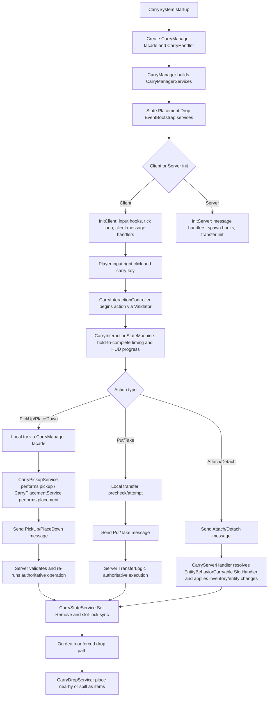

# CarryManager and Handler Pipeline in CarryOn

This document explains the carry management and interaction pipeline centered on `CarryManager` and `CarryHandler`.

It reflects the current implementation:
- `CarryManager` is a facade over dedicated domain services and remains the public authority exposed through `ICarryManager`.
- `CarryHandler` is the orchestration layer that wires input, network messages, server validation, and interaction state progression.
- `CarryInteractionController`, `CarryInteractionStateMachine`, and `CarryInteractionValidator` drive client-side carry action state (`PickUp`, `PlaceDown`, `SwapBack`, `Attach`, `Detach`, `Put`, `Take`, `Interact`).
- `TransferLogic` handles carryable transfer into and out of block entities via pluggable transfer handlers.
- `DeathHandler` enforces carried-item drop behavior on player death based on vanilla keep-contents rules.

## 0. Scope

This pipeline covers:
- `src/Common/Services/CarryManager.cs`
- `src/Common/Services/CarryManagerServices.cs`
- `src/Common/Services/CarryStateService.cs`
- `src/Common/Services/CarryPlacementService.cs`
- `src/Common/Services/CarryPickupService.cs`
- `src/Common/Services/CarryDropService.cs`
- `src/Common/Services/CarryEventBootstrapper.cs`
- `src/Common/Handlers/CarryHandlers/CarryHandler.cs`
- `src/Common/Handlers/DeathHandler.cs`
- `src/Common/Behaviors/EntityBehaviorAttachableCarryable.cs`
- `src/Client/Logic/Interaction/CarryInteractionController.cs`
- `src/Client/Logic/Interaction/CarryInteractionStateMachine.cs`
- `src/Client/Logic/Interaction/CarryInteractionValidator.cs`
- `src/Common/Logic/TransferLogic.cs`
- `src/Common/Models/CarryInteraction.cs`
- `src/CarrySystem.cs`
- [src/API/Common/Interfaces/ICarryManager.cs](https://github.com/NerdScurvy/CarryOnLib/blob/main/src/API/Common/Interfaces/ICarryManager.cs)

---

## 1. High-Level Responsibilities

### 1A. `CarryManager`

Core responsibilities:
- Exposes the public carry API (`ICarryManager`) used by CarryOn internals and other mods.
- Delegates operational behavior to `CarryManagerServices` domain services:
  - `CarryStateService` for watched-attribute state, revisions, slot locks, animation/stat side effects.
  - `CarryPlacementService` for pickup, placement, permission checks, and block entity restore.
  - `EntityBehaviorAttachableCarryable` (via `ICarryableEntitySlotHandler`) for per-slot attach/detach between player hands and entity inventories.
  - `CarryDropService` for drop placement fallback and item spill/drop behavior.
  - `CarryEventBootstrapper` for `ICarryEventHandler` discovery and initialization.
- Maintains transform group resolver registration for renderer-side transform group planning.

### 1A.1 Service Delegation Matrix

`CarryManager` method routing:
- State: `GetAllCarried`, `GetCarried`, `SetCarried`, `RemoveCarried`, `SwapCarried`, `LockHotbarSlots`, `TouchCarriedAttributes`, `GetCarriedRevision` -> `CarryStateService`
- Pickup: `HasPermissionToCarry`, `GetCarriedFromWorld`, `TryPickUp` -> `CarryPickupService`
- Placement: `RestoreBlockEntityData`, `TryPlaceDown`, `TryPlaceDownAt` -> `CarryPlacementService`
- Drop: `DropCarried`, `DropCarriedBlock`, `DropBlockAsItem` -> `CarryDropService`
- Event bootstrap: `InitEvents` -> `CarryEventBootstrapper`

### 1B. `CarryHandler`

Orchestration responsibilities:
- Initializes client and server carry pipelines from `CarrySystem`.
- Registers carry network message types and per-message handlers.
- Wires client input events and game tick loop into `CarryInteractionController`.
- Wires server message handlers into `CarryManager` and `TransferLogic` with authority checks.
- Prevents active hotbar slot switching while carrying in hands.
- Reapplies carry state effects on entity/player spawn so animations/stats/locks are restored.

### 1C. Client Interaction Components

The client interaction system was split into three components during refactoring:

**`CarryInteractionController`** — Top-level orchestrator:
- Creates and manages `CarryInteractionStateMachine` and `CarryInteractionValidator`.
- Provides external hooks for `TryBeginInteraction` and `TryContinueInteraction`.
- Exposes the `ICarryInteractionController` interface consumed by `CarryHandler`.

**`CarryInteractionStateMachine`** — Client interaction state machine:
- Tracks active interaction context in `CarryInteraction`.
- Progresses timed interactions each tick and dispatches corresponding client packets.
- Performs client-side prechecks and local transfer calls (`Put`/`Take`) before server packet send.
- Cancels/completes interaction state and updates carry HUD progress/refresh behavior.

**`CarryInteractionValidator`** — Interaction validation:
- Detects and begins valid interaction intents based on right-click + carry key context.
- Applies permission checks (e.g. `HasPermissionToCarry` for place-down).
- Enforces entity attach/detach validation rules.

### 1D. `TransferLogic`

Transfer subsystem responsibilities:
- Resolves transfer handlers for carryable blocks lazily through `BlockBehaviorCarryable`, either by `transferCode` from the `RegisterTransferHandler` registry or by auto-detecting a block behavior that implements `ICarryableBlockSlotHandler`.
- Validates transfer feasibility (`CanPutCarryable`, `CanTakeCarryable`).
- Executes transfer operations (`TryPutCarryable`, `TryTakeCarryable`) and applies carry state changes through `CarryManager`.

### 1E. `DeathHandler`

Death flow responsibility:
- On player death, drops all carried blocks unless vanilla keep-contents behavior is active (`keepContents == true`).

---

## 2. System Lifecycle Integration

`CarrySystem.Start`:
- Registers carry behaviors (`BlockBehaviorCarryable`, `BlockBehaviorCarryableInteract`, `EntityBehaviorAttachableCarryable`).
- Creates `CarryHandler` and `CarryEvents`.
- Retrieves CarryOnLib mod system and installs `CarryManager` implementation.

`CarrySystem.StartClientSide`:
- Registers client channel.
- Creates renderer/HUD systems.
- Calls `CarryHandler.InitClient`.
- Calls `CarryManager.InitEvents`.
- Registers transform group resolvers (`plant-container`, `display-case`, `mold-rack`, `generic-code-path`).

`CarrySystem.StartServerSide`:
- Registers `EntityBehaviorDropCarriedOnDamage`.
- Registers server channel.
- Creates `DeathHandler`.
- Calls `CarryHandler.InitServer`.
- Calls `CarryManager.InitEvents`.

---

## 3. Carried State Storage Model

`CarryManager.GetCarried` / `SetCarried` / `RemoveCarried` use watched attributes under:
- `AttributeKey.Watched.EntityCarried`
- slot key (`Hands`, `Back`, etc.)
- child keys:
  - `Stack` for block item stack
  - `Data` for serialized block entity data

Important implementation behavior:
- `GetCarried` resolves `ItemStack.Block` if missing after tree deserialization.
- `SetCarried` starts configured carry animation, applies walkspeed modifiers, and updates hand lock state.
- `RemoveCarried` stops animation, removes walkspeed modifier, restores lock states, and clears watched + entity attributes.
- Server-side set/remove calls increment carried revision via `TouchCarriedAttributes` and marks `AttributeKey.Watched.EntityCarried` dirty.
- `TouchCarriedAttributes` stores integer revision at `AttributeKey.CarriedRevision` under the carried root.

---

## 4. Pickup and Place-Down Pipeline

`TryPickUp` flow (`CarryPickupService` via `CarryManager`):
1. Server: permission check (`HasPermissionToCarry`) against claims/reinforcement and external delegates.
2. Reject if target carry slot already occupied.
3. Validate carryability and optimistic pickup behavior (`BlockBehaviorCarryable.OptimisticPickup`).
4. Build `CarriedBlock` from world position (`GetCarriedFromWorld`) and invoke pre-remove delegates.
5. Remove world block (+ clear reinforcement + neighbor update).
6. Set carried state on entity and play carry sound profile.
7. Audit log on server.

`TryPlaceDownAt` + `TryPlaceDown` flow (`CarryPlacementService` via `CarryManager`):
1. Resolve actual placement position (replace selected block or offset by face).
2. For player placements, route through block `TryPlaceBlock` with temporary active-slot phantom stack.
3. Force Shift=true and Ctrl=false during placement attempt (compatibility workaround), then restore controls.
4. For dropped placements (or non-player placement paths), directly exchange block/spawn block entity and call `OnBlockPlaced`.
5. Restore serialized block entity data at final position.
6. Mark block dirty, trigger neighbor update, remove carried state, play sound, raise drop event when applicable.

### 4.1 Phantom-cell reconciliation (client prediction repair)

The client predicts both actions optimistically: the pickup's local capture
applies **no** permission filter, and a place-down writes every predicted cell
before the server answers. The server's repair channel is the vanilla
per-block dirty queue (`MarkBlockDirty` / `MarkBlockEntityDirty`), whose 100 ms
flush delivers `ExchangeBlock` with server truth plus the paired block-entity
removal/data entry. Three asymmetries shape the rules:

- **Multiblock coverage is free.** One `MarkBlockDirty(controller)` walks the
  block's multiblock, so a denial already resyncs every structure part and its
  block entity. Do not widen it to the footprint.
- **The pickup footprint is the multiblock's configured box.**
  `CarryFootprint.GetFootprint` resolves a dummy target to its controller
  (`pos + OffsetInv`), then walks that controller block's
  `BlockBehaviorMultiblock.IterateOverEach` box — the same walk, anchored at the
  same cell, that the placement gate uses (`AddMultiblockFootprint`). Pickup and
  placement therefore cannot disagree about a structure's write set, and the walk
  needs no world reads at all (the behavior's sizes are the only input). Three
  facts the walk rests on:
  - the engine's `OnBlockRemoved` sweeps **every** `BlockMultiblock` cell of that
    box with **no** pointing-back check, so the configured box — not a
    pointing-back filter over a neighborhood — is the true write set;
  - vanilla's registered dummy family (`assets/game/blocktypes/multiblock.json`)
    bounds `dx`/`dz` at ±2 and `dy` at −2..+3, so a mod that wants a wider
    multiblock must register its own dummy variants in the **game** domain (the
    behavior resolves dummy codes there only);
  - the pickup's world write was always engine-exact — `SetBlock(air, controller)`
    triggers that sweep — so only the permission gate and the sign scan could
    under-count, which is exactly where the under-counted radius-2 scan lived
    (`game:jonas-poweramplifier-sideend-*` is the one shipped multiblock that
    leaves ±2: its `dy = +3` row).

  A pre-behavior structure (a controller without the behavior) has no configured
  sizes to walk, so it keeps the older scan: the box the target dummy's own
  `OffsetInv` describes, keeping the dummy cells pointing back at the controller.
- **Attached signs are outside any parent multiblock**, so sign cells are
  reconciled explicitly. `CarrySignScan` is the shared, unfiltered structural
  scan (`CarryFootprint.GetFootprint` + `IsWallSign` + `GetWallSignFacing`),
  used by both sides:
  - pickup denial (`CarryServerHandler.OnPickUpMessage`): reconcile **every**
    candidate sign cell, block and BE, before `FailCarryAction`.
  - pickup success: reconcile only the candidates the client predicted **and**
    the server did not take — the left-behind sign, the one cell the server
    never wrote. A sign that travelled with the carry is not resynced, and a
    successful pickup emits no packets of its own (its `SetBlock(air)` only
    marks the chunk, not the per-block dirty queue).
  - Early validation failures (malformed message, wrong slot,
    `cannot-interact`) still fail without scanning; closing that is a follow-up
    (a client-side permission filter on the local capture is the alternative).
- **Placement spill repairs the predicted cell, not the actual one.** Preflight
  claim-checks attached children at the **estimated** rotation
  (`Block.SuggestedHVOrientation`), and `PlaceAttachedChildren` checks the
  **actual** rotation. When they disagree (estimate 3 vs. actual 2 for a
  `chest-east` at yaw PI/2) and a claim covers the actual child, the parent
  placement still succeeds, so the `WrittenCells` reconcile never runs
  (`placedAt == message.PlacedAt`). The spill branch therefore marks
  `parentPos + estimatedOffset` on both channels: that is where the client's
  phantom lives. The `estimatedSteps` value is hoisted so both call sites use
  one computation.

Pinned by `PickupPhantomReconcileScenarios` (G0–G3, R2, R3),
`MultiblockFootprintScenarios` (G1–G3) and `HandlerPathVanillaWireScenarios`
R6; see `tests/CarryOn.Scenarios/README.md` Decisions 24 and 26.

---

## 5. Drop Pipeline and Failure Fallback

`DropCarried` flow (`CarryDropService`):
- For each requested carried slot, finds candidate placement near entity using `BlockPlacer`.
- If a placement is found, attempts dropped placement (`TryPlaceDown(..., dropped: true)`).
- If no placement or placement fails, falls back to `DropBlockAsItem`.

`DropBlockAsItem` behavior:
- If carried block contains serialized inventory, spills contents as item entities and drops block stack.
- Otherwise uses block drop table; if drops differ from carried stack, block is treated as destroyed.
- Plays break sound, removes carried state, logs audit, and triggers block-dropped carry events with metadata (`blockDestroyed`, `hadContents`, `blockPlaced: false`).

---

## 6. Permission, Rules, and Event Hooks

Permission checks (`CarryPickupService.HasPermissionToCarry`):
- Invokes `CheckPermissionToCarry` delegates first (can explicitly allow/deny).
- Applies reinforcement + claim checks for player entities.
- Non-player entities are restricted only by reinforcement state.
  - **Why, and why that is accepted**: the claim gate is identity-keyed.
    `TriggerCheckPermissionAt` needs an `IPlayer`, and `Claims.TryAccess`/`TestAccess` are
    `IPlayer`-keyed too, so a non-player actor (dropped item, projectile, mod-owned entity)
    has no claim identity to evaluate. "Deny unless permitted" degenerates to "always deny",
    because there is nothing to look up - and defaulting the other way would let every
    claim-protected block be rebuilt by any non-player actor.
  - **Accepted exposure**: an attachable-creature drop (tamed creature detaching into a
    carried item and reattaching) can land inside a *foreign* claim and rebuild the block
    there, because this branch accepts whenever the cell is unreinforced. Claims do not stop it.
  - **Not an oversight.** The real fix is a reach check on the client-supplied placement
    origin — tracked as a known limitation in [Known Issues](../known-issues.md).
    Changing this branch to deny-closed would break every legitimate
    non-player placement path above with no security gain.

Carry event delegate integration points:
- Before pickup: `BeforePickUpBlock`
- Before world remove: `BeforeRemoveBlockFromWorld`
- Before block entity restore: `BeforeRestoreBlockEntityData`
- Permission override: `CheckPermissionToCarry`
- Drop notification: `TriggerBlockDropped`

`CarryEventBootstrapper.InitEvents` initializes registered `ICarryEventHandler` implementations from mod assemblies.

---

## 7. CarryHandler Client Pipeline

`InitClient` registers:
- message types and lock-slot message handler
- carry hotkeys
- in-world action hook (`OnEntityAction`)
- game tick listener (`OnGameTick`)
- active-slot-change prevention hook
- player spawn and player-ready hooks

Runtime behavior:
- `OnEntityAction` starts/cancels interactions through `CarryInteractionController`.
- `OnGameTick` advances interaction timer/progress via `CarryInteractionStateMachine` and refreshes interaction help when carry capability state changes.
- `OnBeforeActiveSlotChanged` prevents hotbar active slot changes while hands slot is carrying.
- On player-ready (client) and server init paths, transfer behaviors are discovered and configured through `TransferLogic.InitTransferBehaviors`.

---

## 8. CarryHandler Server Pipeline

`InitServer` registers:
- all carry message types
- authoritative handlers for interaction, pickup, placement, swapping, attach/detach, transfer put/take, and dismount
- spawn/player-now-playing hooks to reapply carry state side effects
- active-slot-change prevention hook
- transfer behavior initialization when CarryOn is enabled

Validation examples in server handlers:
- pickup/place: slot constraints, can-interact checks, failure-code based user feedback
- reach: every handler that acts on a client-named target calls `CarryReach.IsWithinReach` before
  acting - block pickup, place-down (target cell plus faced neighbour and cell above),
  carryable-interact, ground-storage lift, dropped-carried-block entity pickup, and entity attach.
  Measured from the server-side actor eye to the target cell centre or entity position; creative
  players exempt inside the predicate. See [DD-015](design-decisions.md#dd-015---reach-validation-is-one-handler-level-predicate-anchored-on-the-servers-eye)
- attach/detach: entity existence, range checks, slot validity, occupancy, compatibility, and inventory-open guards
- put/take: delegates to `TransferLogic` and propagates on-screen errors

---

## 9. Slot Handler Pipeline (Attach/Detach)

Attach/detach is handled by `EntityBehaviorAttachableCarryable`, an `EntityBehavior` that implements `ICarryableEntitySlotHandler`. It is added to attachable entities (boats via `boat.json`) and auto-detected by `EntityBehaviorCarryable.SlotHandler`. The client validator routes slot-mode entities to attach/detach actions; the server `CarryServerHandler` resolves the target entity's slot handler and calls it authoritatively.

`EntityBehaviorCarryable.EnsureSlotHandler` resolves the slot handler in this order:
1. `slotHandlerCode` set to a non-empty value other than the reserved `"auto"` → registry lookup of a registered singleton (as-is, then with the `carryon:` prefix). On a miss, a warning is logged and slot attach/detach is **disabled** — there is no fall-through to a different handler.
2. `slotHandlerCode` unset or `"auto"` → auto-detection: the first behavior on the entity (`entity.SidedProperties.Behaviors`) implementing `ICarryableEntitySlotHandler`.
3. Auto-detection: the entity itself implementing `ICarryableEntitySlotHandler`.

`"auto"` is reserved and intercepted before the registry lookup, so it can never collide with a registered `carryon:auto` handler; it also lets a patch force detection over any `slotHandlerCode` inherited from a template or another mod. Resolution runs **once** per entity (`slotHandlerResolved` flag). A slot handler only runs while its target entity is alive, so it does not need to be a singleton — the built-in attachable handler lives directly on an entity behavior (per-entity instance on both client and server) rather than a shared singleton. Modders may still register their own singleton handlers with `ICarryManager.RegisterSlotHandler` and reference them via `slotHandlerCode`.

`EntityBehaviorAttachableCarryable.TryAttach`:
1. Validate target entity range, attachable behavior, and ownership requirements.
2. Validate source carried block in hands and required block entity data.
3. Resolve target slot from selection-box index and ensure slot is not occupied (including seat occupancy checks).
4. Convert carried block inventory payload into attachable slot-compatible backpack attributes.
5. Run compatibility checks (`CanTakeFrom`, `PreventAttaching`, optional `IAttachedInteractions.OnTryAttach`).
6. Move stack into target slot, persist entity inventory/cache updates, remove carried hands state, invoke `IAttachedListener.OnAttached`, play sound, audit.

`EntityBehaviorAttachableCarryable.TryDetach`:
1. Validate target entity and attachable context.
2. Validate source slot occupancy and takeability.
3. Validate source is carryable and that no other player has related storage inventory open.
4. Rebuild carried block entity data from attached stack backup/backpack attributes.
5. Set carried hands state, clear source slot and cached slot storage, persist inventory, shape/chunk dirty, invoke `IAttachedListener.OnDetached`, audit.

`EntityBehaviorAttachableCarryable.OnClientAttachmentToggled` (optimistic state-flip counterpart invoked by the interaction state machine immediately after sending the attach/detach message, before the server reply):
- Invokes `IAttachedListener.OnAttached`/`OnDetached` on the client for the affected slot.
- Marks the entity shape and chunk dirty so the client refreshes visuals immediately.
- On detach, clears the client-side `att-cont-workspace-{slotIndex}-{entityId}-{stackId}` ObjectCache entry (created by the game for attached-container storage UI), so the next storage open rebuilds from the server-synced stack instead of stale cached contents. Without this, detached/re-attached storage contents desync from the server on the client.

Failure codes from slot-handler `CanAttach`/`CanDetach`/`TryAttach`/`TryDetach` are displayed through the public `CarryErrorHelper` using a hybrid rule: bare codes resolve as `carryon:<code>`, codes containing a domain separator resolve verbatim. `SendAttachDetachFailure` (server) and the validator's client display both route through this helper.

---

## 10. Interaction State Machine

`CarryInteraction` stores transient action context:
- `CarryAction`
- elapsed hold time
- source/target carry slot
- target block position
- target entity and slot index
- optional transfer delay override

`CarryInteractionValidator.TryBeginInteraction` (called via `CarryInteractionController`) picks action in priority order, including:
- entity attach/detach
- swap-back
- block interact behavior
- transfer put/take
- block pickup/place-down

`CarryInteractionStateMachine.TryContinueInteraction`:
- validates that preconditions still hold while button is held
- computes required hold duration from behavior settings + config multipliers
- drives HUD progress
- executes action locally and sends corresponding network packet when successful
- emits localized failure messaging for rejected operations
- coalesces interaction-help refresh requests and flushes them safely via reflected HUD method invocation

---

## 11. TransferLogic Integration

Transfer behavior model:
- A carryable block can expose `TransferEnabled` and a `TransferHandler`.
- Handler methods gate and execute transfer (`CanPut/CanTake`, `TryPut/TryTake`).

`TryPutCarryable`:
- requires carried block in hands
- validates target block entity + carryable transfer handler
- invokes transfer handler
- on success removes carried hands block via `CarryManager.RemoveCarried`

`TryTakeCarryable`:
- requires empty hands carry slot
- validates target block entity + carryable transfer handler
- invokes transfer handler to materialize `ItemStack` + block entity data
- on success installs carried hands block via `CarryManager.SetCarried`

---

## 12. Death Handling

`DeathHandler` subscribes to server `PlayerDeath`:
- If player server attributes do not indicate `keepContents == true`, it drops all carried blocks from the dead player entity.
- This aligns carry drop behavior with vanilla keep-inventory semantics.

---

## 13. Summary Flowchart

---

## 14. References

- `src/Common/Services/CarryManager.cs`
- `src/Common/Services/CarryManagerServices.cs`
- `src/Common/Services/CarryStateService.cs`
- `src/Common/Services/CarryPlacementService.cs`
- `src/Common/Services/CarryPickupService.cs`
- `src/Common/Services/CarryDropService.cs`
- `src/Common/Services/CarryEventBootstrapper.cs`
- `src/Common/Handlers/CarryHandlers/CarryHandler.cs`
- `src/Common/Handlers/DeathHandler.cs`
- `src/Common/Behaviors/EntityBehaviorAttachableCarryable.cs`
- `src/Client/Logic/Interaction/CarryInteractionController.cs`
- `src/Client/Logic/Interaction/CarryInteractionStateMachine.cs`
- `src/Client/Logic/Interaction/CarryInteractionValidator.cs`
- `src/Common/Logic/TransferLogic.cs`
- `src/Common/Models/CarryInteraction.cs`
- `src/CarrySystem.cs`
- [src/API/Common/Interfaces/ICarryManager.cs](https://github.com/NerdScurvy/CarryOnLib/blob/main/src/API/Common/Interfaces/ICarryManager.cs)

---

## See Also

- [Transform Template System](transform-template-system.md) — How carryable transform groups are resolved before rendering.
- [Entity Carry Renderer Pipeline](entity-carry-renderer-pipeline.md) — Client rendering pipeline that consumes carried state and resolved transform groups.
- [Carried Plant Container Rendering](carried-plant-container-rendering.md) — Example of resolver-driven carried rendering behavior.
- [Carried Chest-Trunk and Chest Rendering](carried-chest-trunk-rendering.md) — Example of template + group mapping behavior for storage blocks.

---

This document is intended as a technical reference for understanding and debugging carry state, interaction orchestration, and transfer/death handling in CarryOn.
