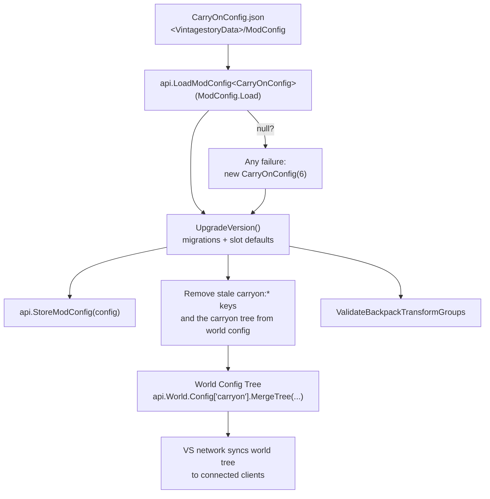
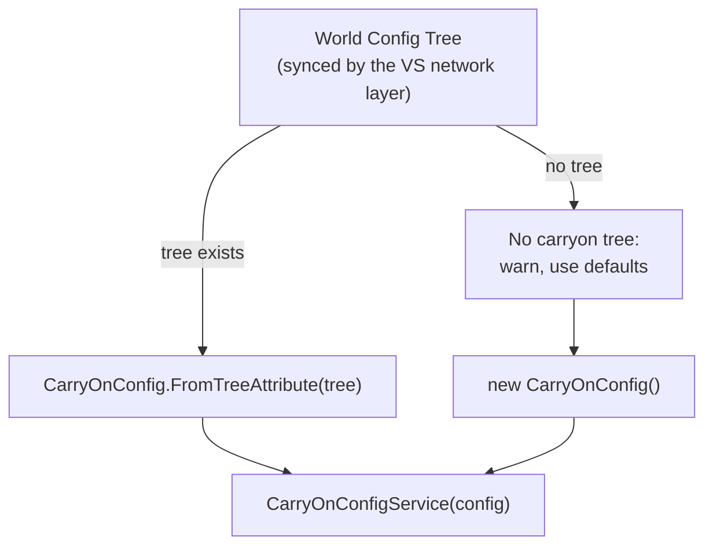
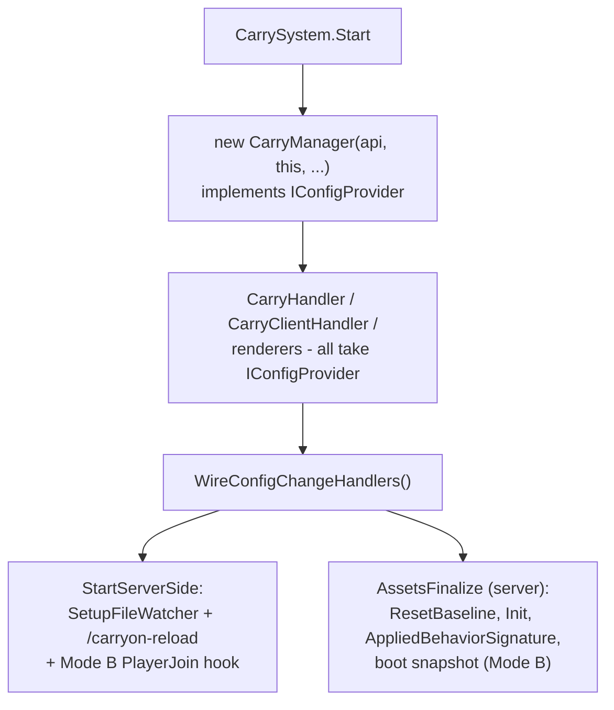
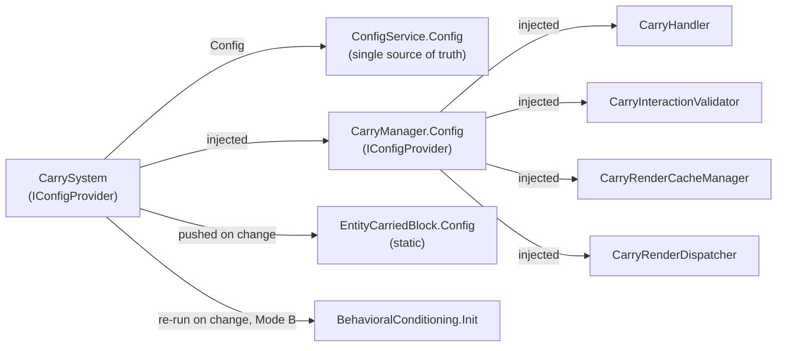
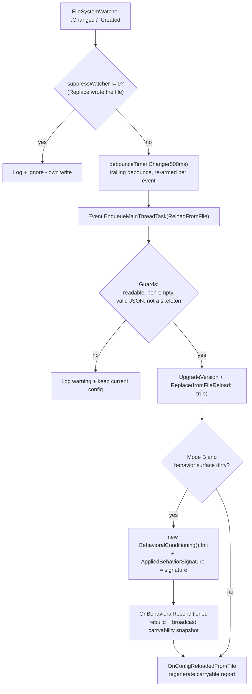
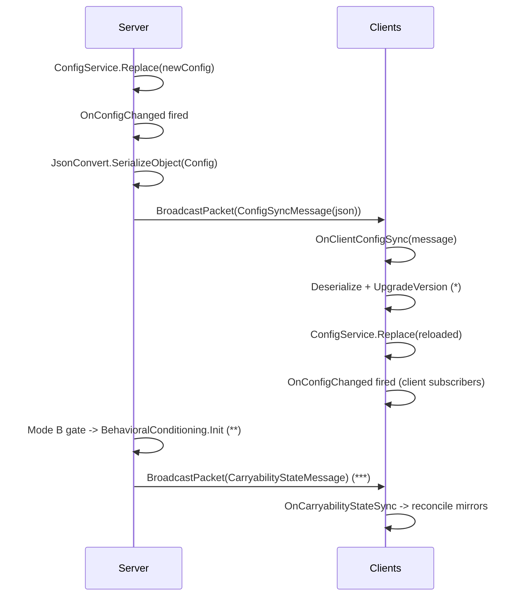
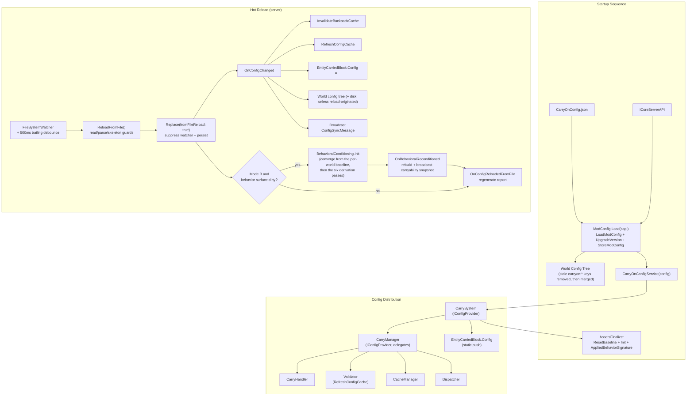

# Config Initialization and Flow

This document traces how `CarryOnConfig` is created, distributed, and hot-reloaded
through the system — from disk to every consumer, and back again when the file changes.

---

## 1. Interface: `IConfigProvider`

**File:** `src/Common/Interfaces/IConfigProvider.cs`

```csharp
public interface IConfigProvider
{
    CarryOnConfig Config { get; }
}
```

Minimal interface. Two implementers:

| Implementer | File | Behavior |
|---|---|---|
| `CarrySystem` | `src/CarrySystem.cs` | `Config => ConfigService.Config` |
| `CarryManager` | `src/Common/Services/CarryManager.cs` | `Config => ConfigProvider.Config` — the provider it was constructed with (i.e. `CarrySystem`) |

### Config Access Patterns

`ICarryManager` (in CarryOnLib) cannot expose `CarryOnConfig` directly —
the config type is too volatile for the API library. Consumers therefore reach
config in one of two ways.

**1. Constructor injection (the common case).** Anything constructed after
`CarrySystem` is handed `CarrySystem` — or the `CarryManager` built on it — as an
`IConfigProvider` parameter and stores it:

```csharp
public CarryHandler(ICarryManager carryManager, IConfigProvider configProvider)
{
    this.configProvider = configProvider;
}
```

Injection is used by the carry services (`CarryManagerServices`, `CarryStateService`,
`CarryDropService`, `CarryPickupService`, `CarryPlacementService`, `CarryPermissionService`,
`CarryableReportService`), the handlers (`CarryHandler`, `CarryServerHandler`,
`CarryClientHandlers`, `CarryClientHandler`, `CarriedBlockEntityFactory`,
`CarriedBlockEntityHandler`), the client renderer stack (`EntityCarryRenderer`,
`CarryRenderCacheManager`, `CarryRenderDispatcher`), the client interaction stack
(`CarryInteractionController`, `CarryInteractionValidator`), and `CarryManager` itself.

**2. The `as IConfigProvider` cast (six sites).** Code that only has an
`ICarryManager` reference — typically a static `Init(ICarryManager manager)` entry
point or a standalone event handler — casts once and caches the result:

```csharp
this.configProvider = carryManager as IConfigProvider
    ?? throw new ArgumentException("carryManager must implement IConfigProvider", nameof(carryManager));
```

| Cast site | File |
|---|---|
| `CarryableInteractionHelpBuilder` | `src/Common/Logic/CarryableInteractionHelpBuilder.cs` |
| `EntityBehaviorAttachableCarryable` | `src/Common/Behaviors/EntityBehaviorAttachableCarryable.cs` |
| `BlockBehaviorGroundStorageBagHelp` | `src/Common/Behaviors/BlockBehaviorGroundStorageBagHelp.cs` |
| `TooHotToPickup` | `src/Events/TooHotToPickup.cs` |
| `DroppedBlockTracker` | `src/Events/DroppedBlockTracker.cs` |
| `EntityBehaviorDropCarriedOnDamage` | `src/Server/Behaviors/EntityBehaviorDropCarriedOnDamage.cs` |

The cast is safe: `CarryManager` is the only `ICarryManager` implementation
and always implements both interfaces. The cast fires once per instance and
has zero hot-path cost.

**No consumer stores a private `CarryOnConfig` copy.** Every read goes through
`IConfigProvider.Config`, which delegates to the live `CarryOnConfigService.Config`.
The only *pushed* copies are the two deliberate exceptions, both documented in
§4: the static `EntityCarriedBlock.Config` and the client's parsed
`PreventSwapFromBackOnTarget` cache.

---

## 2. The Config File and Its Version

| Constant | Value | Source |
|---|---|---|
| `ConfigFile` | `CarryOnConfig.json` | `CarryCodes.ConfigFile` |
| Path | `<VintagestoryData>/ModConfig/CarryOnConfig.json` | `GamePaths.DataPath` + `ModConfig` |
| `CurrentConfigVersion` | `6` | `CarryCodes.CurrentConfigVersion` |

`CarryOnConfig.UpgradeVersion()` runs the migration chain and then back-fills slot
defaults:

```csharp
public void UpgradeVersion()
{
    CarryOnConfigMigrations.Upgrade(this);   // walks v(n) -> v(n+1) until CurrentConfigVersion
    EnsureSlotDefaults();
}
```

`CarryOnConfigMigrations.Upgrade` steps `version` forward one migration at a time
and stamps the final value at the end. Each step is guarded on the config's
**original** `ConfigVersion` matching that step's source version, so the index walk
and the key moves stay in lockstep:

| Step | Migration | What it does |
|---|---|---|
| v0/null → v1 | `MigrateV1ToV2` | Guarded on `ConfigVersion == null`: with a `Legacy` block it maps the legacy flat `*Enabled` keys onto `Carryables` / `CarryablesOnBack` / `Interactables` / `CarryOptions` / `DebuggingOptions` / `CarryablesFilters` (e.g. `AnvilEnabled` → `Carryables.Anvil`, `HarmonyPatchEnabled` → inverted `DebuggingOptions.DisableHarmonyPatch`); without one, only the version is stamped |
| v1 → v2 | `MigrateV1ToV2` | Guarded on `ConfigVersion == null`, so it is a no-op on a structured v1 config — the step only stamps the version |
| v2 → v3 | `MigrateV2ToV3` | Moves back-slot keys from `CarryOptions` to `CarryablesOnBack` (`AllowLargeChestsOnBack` → `CarryOptions.AllowHighCapacityStorageOnBack`, `AllowChestTrunksOnBack` → `CarryablesOnBack.ChestTrunk`, `AllowCratesOnBack` → `CarryablesOnBack.Crate`) |
| v3 → v4 | `MigrateV3ToV4` | Splits `IgnoreCarrySpeedPenalty` into `CarryWalkSpeed.HandsEnabled` / `BackEnabled`, `AllowSprintWhileCarrying` into `HandsAllowSprint` / `BackAllowSprint`, and the nested-dictionary `WalkSpeedOverrides` into the list-based `CarryWalkSpeed.ModifierOverrides` |
| v4 → v5 | `MigrateV4ToV5` | No-op (walk-speed and report defaults were re-expressed) |
| v5 → v6 | `MigrateV5ToV6` | Appends any `CarryOptions.PreventSwapFromBackOnTarget` entries missing from the current defaults; user entries are preserved |

Two more config-level helpers run alongside every load and every applied reload:

- `ValidateBackpackTransformGroups(logger)` — reports backpack entries whose
  transform group cannot be resolved.
- `InvalidateBackpackCache()` — clears the lazy-parsed `BackpackMapping`
  dictionary, which is otherwise cached on the config instance (§5f).

---

## 3. Initialization Sequence

### 3a. Server Startup (`StartPre`)



`ModConfig.Load(ICoreAPI)` (`src/Server/Logic/ModConfig.cs`) returns the loaded
config directly, so the server never deserializes what it just wrote:

```csharp
public CarryOnConfig? Load(ICoreAPI api)
{
    if (api.Side != EnumAppSide.Server) return null;

    CarryOnConfig config;
    try
    {
        var loadedConfig = api.LoadModConfig<CarryOnConfig>(ConfigFile);
        if (loadedConfig != null) { loadedConfig.UpgradeVersion(); config = loadedConfig; }
        else config = new CarryOnConfig(CurrentConfigVersion);
        api.StoreModConfig(config, ConfigFile);
    }
    catch (Exception ex)
    {
        api.Logger?.Error($"CarryOn: Exception loading config: {ex}");
        config = new CarryOnConfig(CurrentConfigVersion);
    }

    // MergeTree does not delete absent keys, so the previous session's
    // carryon:* overrides and the carryon tree itself are removed first.
    ... worldConfig.GetOrAddTreeAttribute(ModId).MergeTree(config.ToTreeAttribute());
    return config;
}
```

The world config tree is written for two reasons: JSON patches and
`enabledCondition` expressions read values from it, and the client receives it
through VintageStory's own world-config sync. A missing world config is logged and
the config is still returned, so CarryOn keeps working (with the caveat that
conditions and client sync have nothing to read).

### 3b. Client Startup (`StartPre`)



The **client** never reads `CarryOnConfig.json` from disk. It receives the config
via the server's world config sync (VS built-in) or, for later changes, via the
`ConfigSyncMessage` packet (§5g).

### 3c. Server + Client Combined (`StartPre`)

```csharp
// src/CarrySystem.cs — StartPre
CarryOnConfig config;

if (api is ICoreServerAPI sapi)
{
    config = new ModConfig().Load(sapi) ?? new CarryOnConfig();
}
else
{
    var carryOnWorldConfig = api.World.Config?.GetTreeAttribute(ModId);
    config = carryOnWorldConfig != null
        ? CarryOnConfig.FromTreeAttribute(carryOnWorldConfig)
        : new CarryOnConfig();
}

ConfigService = new CarryOnConfigService(config);
if (ServerApi != null) config.ValidateBackpackTransformGroups(ServerApi.Logger);
EntityCarriedBlock.Config = config.CarriedBlockEntity;
reconditionOnConfigChange = config.DebuggingOptions.ReconditionOnConfigChange;
```

**Key improvement over the old architecture:** the server no longer performs a
redundant deserialization round-trip. `ModConfig.Load()` returns the loaded config
directly. The world config tree is still written (for patches and client sync),
but the server doesn't read it back.

`ReconditionOnConfigChange` is latched into `reconditionOnConfigChange` here and
used for the rest of the session to decide whether the Mode B join hook and boot
snapshot are wired at all (§3d, §5e).

### 3d. Wiring (`Start` / `StartServerSide` / `AssetsFinalize`)

| Site | What happens |
|---|---|
| `CarrySystem.Start` | Builds `CarryManager`, handlers and renderers (each receiving `this` as `IConfigProvider`), then calls `WireConfigChangeHandlers()` on both sides |
| `CarrySystem.StartClientSide` | Registers `ClientChannel.SetMessageHandler<ConfigSyncMessage>(OnClientConfigSync)` and `SetMessageHandler<CarryabilityStateMessage>(OnCarryabilityStateSync)` |
| `CarrySystem.StartServerSide` | Registers the server channel, then `ConfigService.SetupFileWatcher(api)`, then — **conditionally, on the boot-time `reconditionOnConfigChange` latch** — hooks `api.Event.PlayerJoin` to send the current carryability snapshot to each joiner, then registers `ServerCommands` (`/carryon-reload`, `/carryon-recover`). The hook is wired at boot or not at all; it is never re-wired or unwired by a later reload. |
| `CarrySystem.AssetsFinalize` (server) | `ConditioningBaseline.ResetBaseline()` → first `BehavioralConditioning.Init(api, Config)` (which captures the per-world baseline, then converges and derives) → `ConfigService.AppliedBehaviorSignature = Config.ComputeBehaviorSurfaceSignature()` → under Mode B, caches the boot snapshot → `CarryableReportService.Generate()` |
| Shutdown | `UnwireConfigChangeHandlers()` then `ConfigService.Dispose()` (watcher and debounce timer) |



---

## 4. Config Consumer Chain



| Consumer | Access Path | Reacts to Change? |
|---|---|---|
| `CarryHandler` | injected `IConfigProvider` | Yes — relays to `RefreshConfigCache()` |
| `CarryInteractionValidator` | injected `IConfigProvider` | Yes — re-parses `PreventSwapFromBackOnTarget` |
| `CarryRenderCacheManager` | injected `IConfigProvider` | No — reads live each render tick |
| `CarryRenderDispatcher` | injected `IConfigProvider` | No — reads live each render tick |
| Carry services (`CarryStateService`, `CarryDropService`, …) | injected `IConfigProvider` | No — read live per operation |
| Static `Init` consumers (help builder, behavior helpers, `TooHotToPickup`, `DroppedBlockTracker`) | `as IConfigProvider` cast | No — read live |
| `EntityCarriedBlock` (static) | Pushed via subscriber | Yes — `Config = Config.CarriedBlockEntity` |
| `BehavioralConditioning` | Direct `CarryOnConfig` param | **Yes, under Mode B only** — `Init` re-runs on a file reload when the behavior surface is dirty; otherwise it waits for the next server start |

---

## 5. Config Hotloading

### 5a. Triggers

| Trigger | Initiator | Path |
|---|---|---|
| File change (disk, server only) | `CarryOnConfigService.SetupFileWatcher()` | `OnConfigFileChanged()` → debounce timer → `ReloadFromFile(Watcher)` → `Replace(fromFileReload: true)` |
| Chat command (server) | `/carryon-reload` (`ServerCommands`) | `ConfigService.Reload(Command, caller)` → `ReloadFromFile(Command, caller)` |
| Network sync (client) | Server broadcasts `ConfigSyncMessage` | `CarrySystem.OnClientConfigSync()` → `ConfigService.Replace()` |
| Programmatic | Any code | `ConfigService.Replace(newConfig)` or `NotifyChanged()` (re-fires the event without swapping the instance) |

### 5b. File Watcher (Server Only)

`CarryOnConfigService.SetupFileWatcher(ICoreServerAPI)` creates a
`FileSystemWatcher` on `<VintagestoryData>/ModConfig/CarryOnConfig.json`
(`Changed` and `Created`, `NotifyFilter = LastWrite | CreationTime`):



The debounce is **trailing**: every watcher event re-arms a 500 ms one-shot
`Timer`, so the reload runs only after the file has been quiet for the full
window. That is what makes partial multi-write saves (truncate, then rewrite)
safe without a polling loop.

The watcher is disabled entirely when `DebuggingOptions.DisableConfigWatcher` is
`true`, and it suppresses its own events while `Replace` is running
(`suppressWatcher`, an interlocked counter) so a config write can never loop back
into a reload. `/carryon-reload` deliberately does **not** defer: the command
applies synchronously, even if a watcher event just landed.

Every reload records its outcome — applied or rejected, plus one notice per
warning or confirmation — and reports it beyond the server log. `/carryon-reload`
returns a rejection as a command error and appends each warning to the success
message, so the invoking player reads the result in their own chat; watcher
reloads broadcast their notices to online players holding the `controlserver`
privilege (every online player on a non-dedicated host), with each distinct
warning reaching chat once per session. A reload that changes the behavior
surface while `ReconditionOnConfigChange` is off also warns, naming the changed
sections and `CarryOptions` keys, that they take effect on the next server start.

### 5c. Reload Validation

`ReloadFromFile()` refuses to apply a file it cannot trust, and keeps the current
config in every failure case:

| Guard | Behavior on failure |
|---|---|
| `File.ReadAllText` throws (locked, mid-save) | Warn, keep current config |
| Whitespace-only text | Warn, keep current config |
| `JObject.Parse` throws (invalid JSON) | Warn, keep current config |
| `IsConfigFileSkeleton(fileJson)` — nothing but `ConfigVersion` and empty section shells | Warn, keep current config (a file caught mid-save, which combined with a persist writeback used to clobber a user's edit) |
| `ToObject<CarryOnConfig>()` returns null | Warn, keep current config |

On success the config is deserialized **from the exact text that was validated**,
not from a second read, so the bytes the guards accepted are the bytes applied.
A command-triggered reload reuses this same path — `/carryon-reload` is not a
"force" that bypasses validation.

### 5d. `Replace()` — The Central Mutation Point

`CarryOnConfigService.Replace(CarryOnConfig newConfig, bool fromFileReload = false)`
swaps the in-memory config and fires the change event:

```csharp
public void Replace(CarryOnConfig newConfig, bool fromFileReload = false)
{
    Config = newConfig;
    Interlocked.Increment(ref suppressWatcher);          // our own write must not re-trigger the watcher
    var priorPersistSuspended = persistSuspended;
    if (fromFileReload) persistSuspended = true;         // IsReloadOriginated
    try { OnConfigChanged?.Invoke(newConfig); }
    finally
    {
        persistSuspended = priorPersistSuspended;
        Interlocked.Decrement(ref suppressWatcher);
    }
}
```

`IsReloadOriginated` is what keeps a file-originated change from being written back
to the file: the file is already the source of truth, and re-persisting it would
clobber the user's edits. In-memory propagation (the world config tree, the event
subscribers) still happens, so conditional behavior evaluation sees the new values.

### 5e. Mode A vs Mode B — the Recondition Gate

`ReloadFromFile()` applies the config, then decides whether behavioral conditioning
must re-run:

```csharp
reloaded.UpgradeVersion();
Replace(reloaded, fromFileReload: true);
reloaded.ValidateBackpackTransformGroups(serverApi.Logger);

if (reloaded.DebuggingOptions.ReconditionOnConfigChange)      // Mode B
{
    var signature = reloaded.ComputeBehaviorSurfaceSignature();
    if (AppliedBehaviorSignature == null
        || !string.Equals(AppliedBehaviorSignature, signature, StringComparison.Ordinal))
    {
        new BehavioralConditioning().Init(serverApi, Config);
        AppliedBehaviorSignature = signature;                 // refreshed only after a successful pass
        OnBehavioralReconditioned?.Invoke(Config);
    }
}
OnConfigReloadedFromFile?.Invoke(Config);
```

| Mode | `ReconditionOnConfigChange` | Reload behavior |
|---|---|---|
| **A** (default) | `false` | The config applies; carryability waits for the next server start. No conditioning pass, no snapshot. The join hook was never wired and stays unwired for the session. |
| **B** | `true` | If `ComputeBehaviorSurfaceSignature()` differs from `AppliedBehaviorSignature`, conditioning re-runs from the per-world baseline — so the pipeline converges to what a fresh boot with the same config would produce, and the edit is undone just as cleanly when it is reverted — `OnBehavioralReconditioned` fires (snapshot rebuilt and broadcast), and the boot snapshot/join hook stay wired. If the signature is unchanged, nothing behavioral happens — the pass is skipped even in Mode B. |

**The gate reads the latch, not the file.** `ReloadFromFile` tests
`CarryOnConfigService.ReconditionOnConfigChangeEnabled` — the value captured once at
`StartPre` — and ignores the reloaded file's own
`DebuggingOptions.ReconditionOnConfigChange`. A file edit therefore cannot switch a
running server's mode mid-session, including *into* live reconditioning. When the two
disagree, `WarnOnModeMismatch` logs a `Warning` naming the file value, the boot value,
and that the file value takes effect on the next server start; nothing is re-armed and
the user's file is left untouched. **Decision: do not "fix" this by keying
the join hook off the live flag or by gating the reload at send time** — the boot latch is
the documented "(requires restart)" contract, and keying off the
live flag was considered and rejected for exactly that reason.

`ComputeBehaviorSurfaceSignature()` (`src/Common/Models/CarryOnConfig.cs`)
serializes exactly the surface that shapes conditioning output:
`Carryables`, `CarryablesOnBack`, `Interactables`, `CarryablesFilters`, and the two
`CarryOptions` keys the behavioral passes consult
(`PickupGroundStorageBagWhileCarrying`, `AllowHighCapacityStorageOnBack`).
Speed/hunger/distance edits never dirty the gate.

`OnConfigReloadedFromFile` fires on every *applied* file reload, in both modes,
and only after the Mode B pass has run — so a report regenerated from it reflects
the actually applied behaviors rather than the config as written.

### 5f. Subscriber Chain (`WireConfigChangeHandlers()`)

Wired in `CarrySystem.Start()` and unwired on shutdown:

| Event | Order | Subscriber | Effect |
|---|---|---|---|
| `OnConfigChanged` | 1 | `Config.InvalidateBackpackCache()` | Clears the lazy-parsed `BackpackMapping` dictionary |
| `OnConfigChanged` | 2 | `CarryClientHandlers?.RefreshConfigCache()` | `CarryClientHandler` → `CarryInteractionController` → `CarryInteractionValidator` re-parses `PreventSwapFromBackOnTarget` into class/code matchers |
| `OnConfigChanged` | 3 | `EntityCarriedBlock.Config = Config.CarriedBlockEntity` | Carried block entity behavior settings (static field) |
| `OnConfigChanged` | 4 | (server) persist world config tree + disk | Always writes the world config tree so conditions re-evaluate; `StoreModConfig` is skipped when `ConfigService.IsReloadOriginated` |
| `OnConfigChanged` | 5 | (server) broadcast `ConfigSyncMessage` | `JsonConvert.SerializeObject(Config)` → `ServerChannel.BroadcastPacket` |
| `OnConfigChanged` | 6 | `carryableReportService?.Generate()` | Skipped when `IsReloadOriginated` — the reload path regenerates after conditioning instead |
| `OnConfigReloadedFromFile` | — | `carryableReportService?.Generate()` | Regenerates once the applied config (and any recondition) is in place |
| `OnBehavioralReconditioned` | — | `RebuildAndBroadcastCarryabilitySnapshot()` | Rebuilds the snapshot from `BuildStateMessage` and broadcasts it; fires only in Mode B when the gate passed |

There is no forwarding to per-consumer `UpdateConfig()` methods. Consumers read
config live from `IConfigProvider`; only caches that cannot be recomputed per read
(backpack mapping, the validator's parsed matchers, the static entity config) need
a push.

### 5g. Network Sync



> **(\*) `UpgradeVersion()` is a no-op on this path.** The server always
> serializes its already-upgraded config (current version 6). The client calls
> `UpgradeVersion` only because it uses the same `CarryOnConfig`
> deserialization code path as the server — a defensive guard in case the
> source is an older server or corrupt data.
>
> **(\*\*)** The client never runs conditioning; it receives the result.
>
> **(\*\*\*)** Only in Mode B, and only when the behavior surface is dirty —
> see §5e.

---

## 6. Full Flow Diagram



---

## 7. Key Design Points

- **`ConfigService` is the single source of truth.** `CarrySystem.Config` delegates
  to it, and `CarryManager.Config` delegates through `CarrySystem` via `IConfigProvider`.
- **No private copies.** Consumers read config live from `IConfigProvider`; the only
  pushed copies are the two caches that cannot be recomputed per read, and both are
  refreshed by a subscriber.
- **Server-authoritative.** Only the server reloads from disk. Clients receive the
  config as a serialized JSON message and never touch the file.
- **One serialization at startup.** `ModConfig.Load()` returns the loaded config
  directly. The server no longer reads it back from the world config tree. The
  world tree is still written (for patches, conditions, and client sync), but only
  the client deserializes from it.
- **Reloads are guarded, and a failed reload is a no-op.** Empty, unreadable,
  invalid-JSON, and skeleton files are all rejected with a warning, leaving the
  active config in place; the applied bytes are the validated bytes.
- **File-originated changes are never written back to the file.** `Replace(...,
  fromFileReload: true)` suspends persistence and suppresses the watcher's own
  events, while still updating the world config tree so conditions re-evaluate.
- **Two modes, one gate.** Mode A (default) keeps restart semantics. Mode B re-runs
  conditioning only when `ComputeBehaviorSurfaceSignature()` differs from the
  signature recorded at boot or the last successful pass, and only then refreshes
  and broadcasts the carryability snapshot. The signature is refreshed only after a
  pass that did not throw, so a failed conditioning leaves the gate dirty for a retry.
- **The cast pattern is a deliberate trade-off.** `ICarryManager` (CarryOnLib)
  can't reference the volatile `CarryOnConfig` type. Most consumers take
  `IConfigProvider` by constructor; the six `as IConfigProvider` sites exist only
  where nothing but an `ICarryManager` is available. The cast is safe
  (`CarryManager` always implements both) and has zero hot-path cost.

---

## 8. References

- `src/Common/Interfaces/IConfigProvider.cs`
- `src/Common/Logic/CarryOnConfigService.cs` — watcher, debounce, reload guards, events, recondition gate
- `src/Common/Logic/Config/CarryOnConfigMigrations.cs` — version steps
- `src/Common/Models/CarryOnConfig.cs` — schema, `UpgradeVersion`, `ComputeBehaviorSurfaceSignature`
- `src/Common/Models/CarryCodes.cs` — `ConfigFile`, `CurrentConfigVersion`
- `src/Common/Services/CarryManager.cs` — `IConfigProvider` implementation
- `src/CarrySystem.cs` — `StartPre` (config acquisition), `Config` property, `WireConfigChangeHandlers()`
- `src/CarrySystem.Lifecycle.cs` — watcher setup, join hook, `AssetsFinalize` conditioning + signature
- `src/CarrySystem.Configuration.cs` — subscribers, client sync, snapshot broadcast and reconciliation
- `src/Server/Logic/ModConfig.cs` — server load, migration, world-tree merge
- `src/Server/Logic/ServerCommands.cs` — `/carryon-reload`
- `src/Server/Logic/BehavioralConditions/BehavioralConditioning.cs` — the pipeline a Mode B reload re-runs

## See Also

- [Behavioral Conditioning](behavioral-conditioning.md) — the pass-0 baseline and the six derivation passes, and what a Mode B reload re-runs.
- [CarryOnConfig.json Reference](../carryon-config.md) — every field, default, and upgrade step.
- [Automatic Behavior Assignment](../automatic-behavior-assignment.md) — how `CarryablesFilters` shapes which blocks end up carryable.
- [CarryManager and Handler Pipeline](carry-manager-and-handlers.md) — where the injected consumers are constructed.
